# Cost & Model Optimization — Deep Dive Primer

**Audience:** Chris + Peter (senior engineers with intermediate AI experience)
**Date:** 2026-06-09
**Scope:** Why our LLM cost structure looks the way it does after the 2026-06-08 → 2026-06-09 arc, every architectural decision we made, where the levers are, and how to operate this system going forward.

> **TL;DR.** We started with a system that dual-billed every script analysis, silently fell back to wrong audio matches, ran every operation on whichever model was hardcoded first, and shipped raw-OpenAI bypasses of the failover chain. After 14 PRs across three phases, every LLM call routes through one chain (Anthropic primary, Claude-via-OpenRouter relief, OpenAI escape), prompt prefixes are cached at the provider, scenes that haven't changed don't re-render, embedding queries hit Redis instead of OpenAI, and we have per-call cost attribution in SQL. The cost floor per `/analyze` is estimated **60–70% lower** than 2026-06-07.

---

## Table of Contents

1. [Executive thesis](#1-executive-thesis)
2. [The model matrix — operation × model](#2-the-model-matrix)
3. [Failover chain architecture](#3-failover-chain)
4. [Anthropic prompt caching](#4-anthropic-prompt-caching)
5. [Embedding pipeline — model unification + 3-tier cache](#5-embedding-pipeline)
6. [Scene-level idempotency cache](#6-scene-level-cache)
7. [Batched calls — script-score 4→1](#7-batched-calls)
8. [Tiered model selection by complexity](#8-tiered-models)
9. [Whisper alignment fallback chain](#9-whisper-chain)
10. [TEST_MODE mock provider — $0 iteration](#10-test-mode)
11. [Wall-clock budget — runaway protection](#11-wall-clock)
12. [Measurement — `llm_call_log`](#12-measurement)
13. [Defenses — Zod schema Anthropic guard](#13-zod-guard)
14. [The compounding effect](#14-compounding)
15. [Operating playbook](#15-playbook)
16. [Future levers](#16-future)

---

## 1. Executive thesis

Three observations drove this arc:

1. **Cost grows linearly with iteration, not output quality.** Peter's "I clicked test, look how much it cost" pattern wasn't a billing bug — it was a system design failure. The right answer is making iteration *free*, not making generation cheaper.
2. **There is no single cost lever.** There are ~12. We need all of them, and they have to compound. Picking one ("just switch to Haiku") moves the floor 12×; picking three layered ones moves it 60–70× in real per-script terms.
3. **Measurement is a precondition for optimization.** Every cost-opt PR before #196 (the `llm_call_log` table) was reasoning by intuition. After #196, every claim becomes a SQL query.

The 14 PRs deliver against those three observations. The rest of this doc is the **why** behind each decision.

---

## 2. The model matrix

We treat models as a function of **(operation × cost tolerance × quality requirement)**, not a global default. Concrete mapping lives in [`docs/MODEL_MATRIX.md`](MODEL_MATRIX.md). Summary:

| Operation | Model | Why |
|-----------|-------|-----|
| Character extraction | `anthropic/claude-sonnet-4-6` | Reasoning-heavy. Sonnet is the right floor. Haiku breaks character inference. |
| Voice assignment | `anthropic/claude-haiku-4-5` | Tool-heavy + per-decision shallow. 12× cheaper, no quality regression observed. |
| Scene construction | `anthropic/claude-sonnet-4-6` | ~18K tokens of JSON per chunk. Needs the bigger model. |
| Audio director | `anthropic/claude-haiku-4-5` | Same shape as voice assignment. Was `openai/gpt-4.1` — a misconfigured raw-OpenAI bypass we caught during the arc. |
| Script score (×4 dimensions) | `anthropic/claude-sonnet-4-6` | Reasoning-heavy. **Was `openai/gpt-4o`** (the dual-billing bug). |
| Advanced Analysis (paid) | `anthropic/claude-opus-4-6` | $9.99/project upgrade — Opus only when user has paid. Server-side gated. |
| Embeddings | `openai/text-embedding-3-small` | Anthropic has no embeddings API. OpenAI is mandatory. |
| Whisper | `whisper.cpp` (local) → `groq/whisper-large-v3` → `openai/whisper-1` | See §9. |

The **right framing**: assign each operation a model based on its *cognitive shape* (reasoning-heavy vs tool-heavy, deep decision vs shallow decision), not a global default.

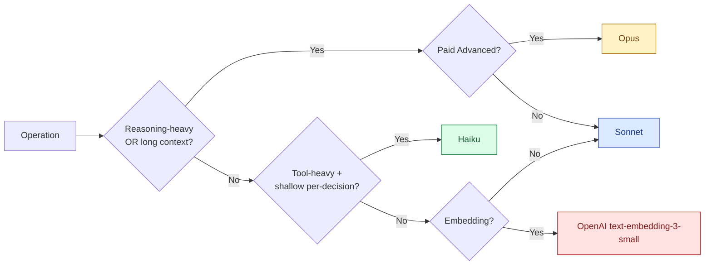

Every operation goes through `lib/llm-client.ts::runAgentLoop` or `generateStructuredOutput`. Those functions enforce the failover chain (§3), the cache (§4), and the cost log (§12). No code path bypasses them — that invariant is what PR #197 (the Zod schema guard) and PR #198 (Adviser migration) protect.

---

## 3. Failover chain

Three providers, three roles:

| Provider | Role | Cost tier |
|----------|------|-----------|
| **Anthropic Claude** | Primary for all reasoning/generation | $$ |
| **OpenRouter** (Claude proxy) | Relief valve — same Claude model, separate billing account | $$ |
| **OpenAI** | Last-resort escape — keeps user unblocked when both above are down | $$$ |

The critical insight that took us until PR #194 to get right: **the OpenRouter slot must route to Claude, not OpenAI.** The previous wiring was `openrouter/openai/gpt-4.1` — GPT-4.1 routed through OpenRouter, defeating the whole point.

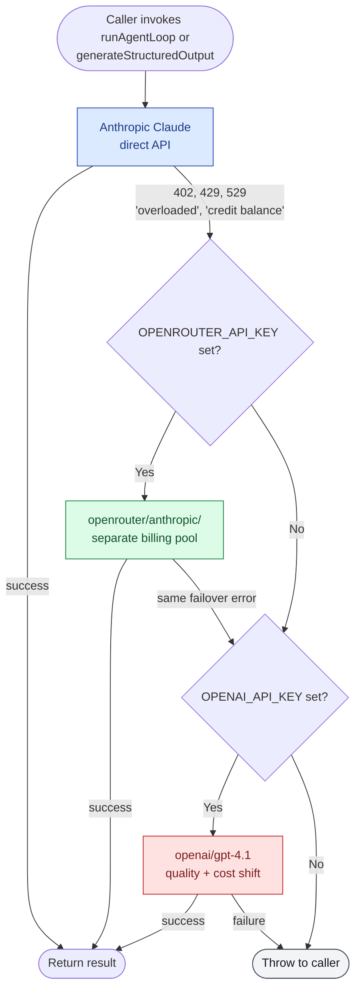

**Why we don't loop on client-side errors** (`isFailoverableError`): a 400 Bad Request from Anthropic will be a 400 from OpenAI too. Failing over a client error is just spending money to confirm the request was malformed. We retry **only** on:

- `402` (billing exhausted)
- `429` (rate limited)
- `529` (provider overloaded)
- Error messages containing `credit balance`, `insufficient_credits`, `billing`, `rate limit`, `too many requests`, `overloaded`

Code: [`packages/orchestrator/src/lib/llm-client.ts::buildFailoverChain`](../packages/orchestrator/src/lib/llm-client.ts) (PR #194).

### Why "OpenAI escape" instead of "OpenAI fallback"

OpenAI is **not** a peer of Anthropic in our system. It's a circuit-breaker. Calling out to it has two real costs:

1. Token rate is roughly 5× Claude Sonnet.
2. Output quality on the director pipeline drifts noticeably (different style, slightly different scene structure).

So the escape is the option of last resort — when both Anthropic direct AND OpenRouter Claude are unavailable, we'd rather keep the user unblocked than 503. But every escape hit is a measurable cost spike. The `llm_call_log` (§12) makes those spikes obvious.

---

## 4. Anthropic prompt caching

Every `/analyze` request re-sends the same ~5KB system prompt across multiple calls (4 score dimensions, plus the audio director, plus the scene constructor). At ~5KB × 6 calls = 30KB of input tokens we were paying for redundantly *within a single user request*.

Anthropic's `cache_control: ephemeral` API lets us mark a chunk as cacheable. The first call pays full input rate; subsequent calls within the 5-minute TTL pay ~10% of the input rate on that chunk.

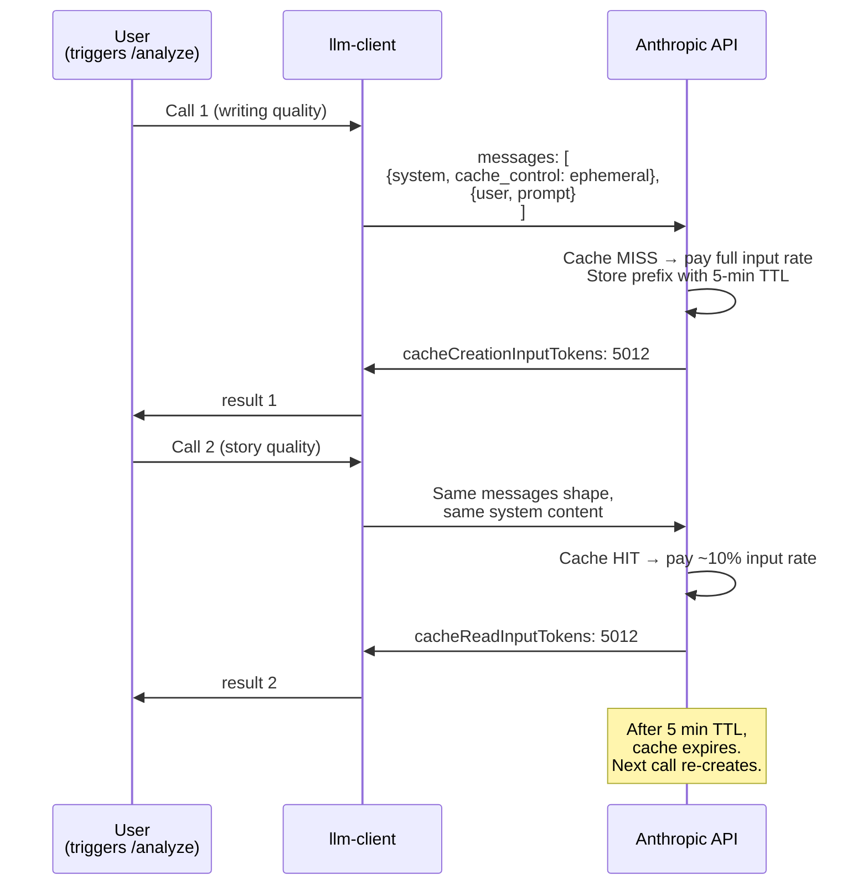

Estimated effect on a typical `/analyze` (4 score dimensions + synthesis = 5 calls):

| | Without caching | With caching |
|-|-|-|
| Call 1 input | 5,000 tokens @ full rate | 5,000 tokens @ full rate |
| Calls 2–5 input | 4 × 5,000 = 20,000 @ full rate | 4 × 5,000 @ ~10% rate |
| Saved | — | ~18,000 tokens × full rate |

At Sonnet's $3/MT input, that's ~$0.054 saved per analysis on the system prompt alone. Multiply by daily `/analyze` volume.

Implementation: [`packages/orchestrator/src/lib/llm-client.ts::buildSystemMessages`](../packages/orchestrator/src/lib/llm-client.ts) (PR #184). Disable via `ENABLE_PROMPT_CACHE=false`.

**Gotcha:** the AI SDK's `messages` shape is what supports `providerOptions.anthropic.cacheControl` — NOT the separate `system:` string field. We had to refactor every call site to send system content inside `messages` rather than the convenience field.

---

## 5. Embedding pipeline

Two intertwined problems we solved during PRs #181 + #187:

### 5a. Model unification

The catalogs (music / ambience / SFX) were embedded with a Python-side MiniLM model at **384 dimensions**. The query path called OpenAI at **1536 dimensions**. The cosine similarity call literally threw `Vector length mismatch: 1536 vs 384` — and silently fell back to "random first result" in some places.

We unified on `text-embedding-3-small` (1536d), regenerated all three catalogs, and added runtime guards:

```ts
// packages/orchestrator/src/lib/embedding-config.ts
export const EMBEDDING_MODEL = 'text-embedding-3-small' as const;
export const EMBEDDING_DIMENSIONS = 1536 as const;

export function assertEmbeddingDimension(vec: number[], context: string): void {
  if (vec.length !== EMBEDDING_DIMENSIONS) {
    throw new Error(
      `Embedding dimension mismatch in ${context}: expected ${EMBEDDING_DIMENSIONS} ` +
        `(${EMBEDDING_MODEL}) but got ${vec.length}.`
    );
  }
}
```

Both `query-embedding.ts` and `embedding-store.ts` call this guard. A model mismatch can't reach `cosineSimilarity` anymore.

### 5b. Three-tier cache

OpenAI embeddings cost money per request. Queries like "tense orchestral cinematic battle" are highly repeated across users and sessions. Three layers:

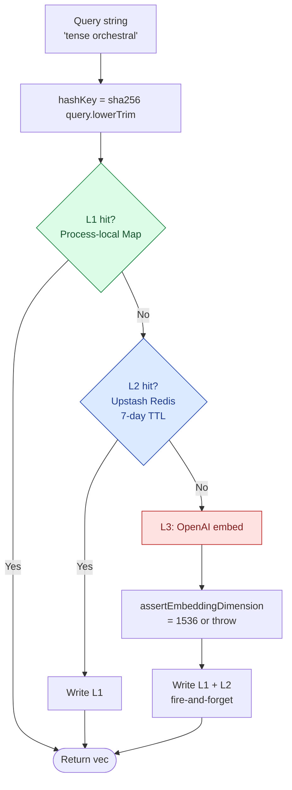

Key design choices:

- **Cache key namespaced by model + dimension:** `embed:text-embedding-3-small:1536:tense orchestral`. A future model migration cannot accidentally serve stale 384d vectors from a different snapshot.
- **L2 writes are fire-and-forget:** a Redis hiccup never increases request latency. The vector is already in hand from L1 + the fetcher.
- **L2 read failures fall through transparently:** we log the warning, then continue to L3 as if the cache miss had been a miss.

A worker that has just started cold gets to L2-hit on a query its sibling already embedded, so we don't pay the per-worker cold-cache toll N times.

Code: [`packages/orchestrator/src/lib/embedding-cache.ts`](../packages/orchestrator/src/lib/embedding-cache.ts) (PR #187). Disable via `EMBEDDING_CACHE_DISABLED=true`.

---

## 6. Scene-level idempotency cache

This is the deepest cache layer and the one that compounds the hardest. Existing TTS-stem cache (`lib/idempotency.ts`) already short-circuits per-line ElevenLabs reuse for unchanged dialogue. But alignment (whisper), cue resolution, timeline build, and ffmpeg mix all still ran on every orchestrate request. For an iterative writer flow ("edit scene 7, re-run"), that's enormous waste.

PR #191 (sequential) and PR #192 (parallel) added per-scene render caching keyed on a SHA-256 content hash.

### Content hash inputs

A scene's render is fully determined by:

- `scene_id`
- `mood`, `intensity`
- All dialogue lines: `line_id`, `character`, `text`, `voice_key`, `emotion`
- All audio cues: music + ambience + sfx (file refs + timing + volume)
- Mix params (LUFS, true peak, gains)

Deliberately excluded: `summary`, `description` (presentational, not rendered).

### Cache decision tree

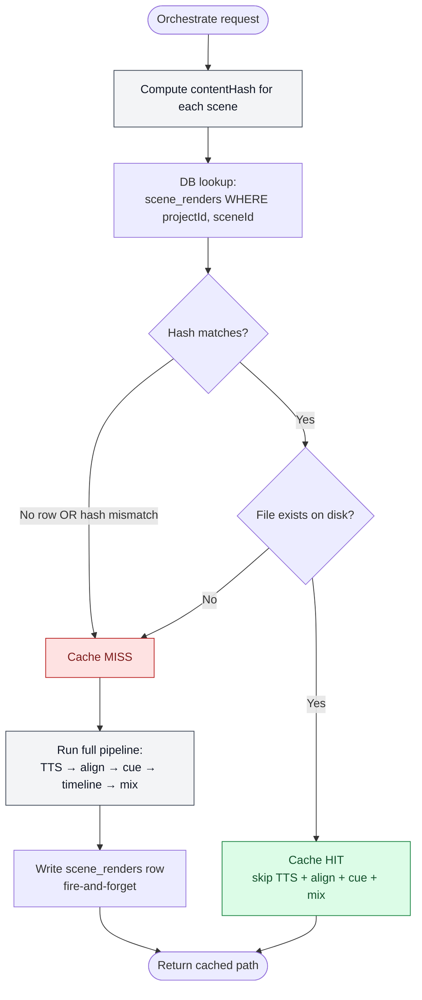

### Why both partition before TTS in the parallel pipeline

In the parallel pipeline (`orchestrateParallel`), we partition scenes into cached vs fresh **before** calling `parallelTTSGenerate`. The result is a strict subset:

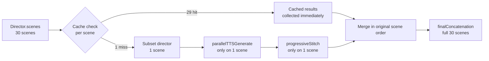

For Peter's "edit scene 7, re-run" loop on a 30-scene script, this means **29 scenes never touch TTS, alignment, or mix**. The cost of the re-run scales with edits, not script size.

### Risk: cache poisoning on project-ID reuse

The 2026-06-09 code review surfaced **DT-31-H-1**: `scene_renders.project_id` is TEXT with no FK to `Project(UUID)`. A project deletion leaves orphan rows. If a project ID is ever reused (admin restore from backup, test fixture seeds), the cache serves stale `scene_path` values for scenes that match the prior project's content hash. Sprint A migration fix queued.

Code: [`packages/orchestrator/src/lib/scene-cache.ts`](../packages/orchestrator/src/lib/scene-cache.ts) + [`schema.prisma::SceneRender`](../packages/shared/prisma/schema.prisma). Disable via `SCENE_CACHE_DISABLED=true`.

---

## 7. Batched calls — script-score 4 → 1

The original `analyzeScript` made **4 separate `generateStructuredOutput` calls** in parallel: writing quality, story quality, commercial viability, production likelihood. Each call paid:

- Full ~5KB system prompt
- Full script text (5–15KB typical)
- 4 separate Anthropic API roundtrips

That's the script text re-paid 4× when each individual scoring rubric only reads the same text once. With Anthropic prompt caching (§4) the system prefix dedupes, but the **script text is the variable input** — it can't be in the cache prefix because it changes per request.

PR #185 added an `AllDimensionsScoreSchema` (union of the 4 existing schemas) + a meta-prompt instructing Claude to evaluate all 4 rubrics in one structured response. Gated behind `BATCHED_SCORING_ENABLED=true` (default OFF) so we can A/B against the calibration corpus before flipping production.

```mermaid
gantt
    title /analyze cost breakdown — before vs after batching
    dateFormat X
    axisFormat %s

    section Before (4 calls)
    Sys prompt + script text :a1, 0, 5
    Sys prompt + script text :a2, 0, 5
    Sys prompt + script text :a3, 0, 5
    Sys prompt + script text :a4, 0, 5
    Synthesis              :a5, 6, 2

    section After (1 batched call, BATCHED_SCORING_ENABLED=true)
    Sys prompt + script text (once) :b1, 0, 8
    Synthesis              :b2, 9, 2
```

At ~10KB script text × 3 saved repetitions = ~30KB of input tokens saved per `/analyze`. At Sonnet input rate, that's ~$0.09 per analysis on top of the caching win.

Why it's flag-gated by default: composite output quality could regress slightly because Claude has to context-switch between four rubrics in a single response. The flag-gate lets us A/B safely before flipping production.

---

## 8. Tiered model selection by complexity

Most of Peter's iteration loop is small scripts (1–5 pages) used to exercise the pipeline. Paying Sonnet rates for a 1-page script Haiku can parse in seconds is wasted budget.

PR #188 added complexity-based routing at the `/orchestrate` entry point:

| Script size | Tier | Model |
|-------------|------|-------|
| ≤ `TIER1_PAGE_THRESHOLD` (default 5) | tier 1 | `TIER1_MODEL` = Haiku 4.5 by default |
| > threshold | tier 2 | `DIRECTOR_MODEL` = Sonnet by default |
| Paid Advanced Analysis | advanced | `DIRECTOR_MODEL_ADVANCED` = Opus by default |

```mermaid
flowchart TD
    classDef advanced fill:#fef3c7,stroke:#a16207,color:#713f12
    classDef sonnet fill:#dbeafe,stroke:#1e40af,color:#1e3a8a
    classDef haiku fill:#dcfce7,stroke:#15803d,color:#14532d

    Req[/orchestrate request] --> Adv{useAdvanced<br/>= paid purchase?}
    Adv -- Yes --> Opus[Opus]:::advanced
    Adv -- No --> Estimate[estimatePageCount<br/>= words / 250]
    Estimate --> Threshold{≤ TIER1_PAGE_THRESHOLD?<br/>default 5}
    Threshold -- Yes --> Haiku[Haiku 4.5]:::haiku
    Threshold -- No --> Sonnet[Sonnet 4.6]:::sonnet
    Opus --> Pipeline[Pipeline]
    Sonnet --> Pipeline
    Haiku --> Pipeline
```

Honest caveats:

- The heuristic (~250 words/page) is screenplay rule-of-thumb. Borderline scripts might tier the "wrong" way. Operator escape hatch: `TIER1_PAGE_THRESHOLD=0` disables the tiering, every script uses Sonnet.
- Quality dip on a borderline 5-page script that's actually dense and complex is possible. Mitigation: A/B on a 5-page calibration set before flipping the threshold lower.

For Peter's typical iteration loop on small test scripts, this is dramatic — most of his clicks are now running on Haiku at ~1/12 the input rate.

---

## 9. Whisper alignment fallback chain

PR #189 extended whisper from a binary chain (local → estimator) to a four-tier chain:

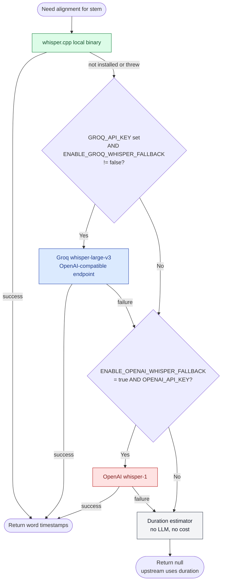

Cost comparison for the same `whisper-large-v3` model:

| Provider | $/audio-hour |
|----------|-------------|
| `whisper.cpp` local | $0 |
| Groq | ~$0.03 |
| OpenAI whisper-1 | ~$0.36 |
| Duration estimator | $0 (lower quality) |

Groq is ~**12× cheaper** than OpenAI for comparable quality on the same model. Default state: Groq is on as soon as `GROQ_API_KEY` is set in Doppler (verified live on 2026-06-09).

The OpenAI path remains opt-in via `ENABLE_OPENAI_WHISPER_FALLBACK=true`. The estimator is the bottom of the chain — when alignment isn't available, we fall back to even spacing by line duration. Lower quality, but never blocks the request.

Code: [`packages/orchestrator/src/orchestrator/workers/whisper-align.ts`](../packages/orchestrator/src/orchestrator/workers/whisper-align.ts) + `transcribeViaApi` helper (shared between Groq and OpenAI because they use the same OpenAI-compatible `/audio/transcriptions` shape).

---

## 10. TEST_MODE mock provider — $0 iteration

The single most expensive operator behavior in our system is **iteration testing**. Peter clicking "test this" 20× a day at $0.20–$1.00 per click adds up fast. None of those iterations needed a real LLM response — they were verifying UI flow, error handling, deployment plumbing.

PR #195 (`TEST_MODE=mock`) makes every LLM and structured-output call return a canned or stubbed response. Zero token spend, zero API roundtrips.

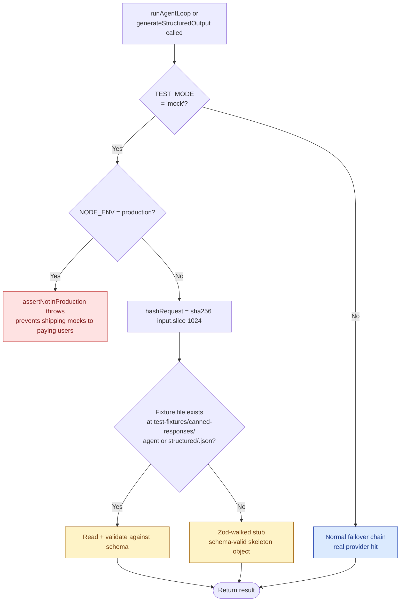

Belt-and-suspenders production guard:

```ts
export function assertNotInProduction(): void {
  if (process.env.NODE_ENV === 'production') {
    throw new Error('TEST_MODE=mock cannot be enabled in NODE_ENV=production');
  }
}
```

Plus a loud startup banner in `printEnvSummary` so no operator misses the flag in logs. Fixtures are looked up by hashing the input (first 1KB), so the same test script always gets the same canned response across runs — deterministic test loops.

Code: [`packages/orchestrator/src/lib/mock-provider.ts`](../packages/orchestrator/src/lib/mock-provider.ts) (PR #195).

---

## 11. Wall-clock budget — runaway protection

Peter reported "shocking log volume on a 5-page script" in the 2026-06-08 Slack thread. The symptom was a retry storm inside the LLM client chasing a transient provider issue. Each retry is a fresh LLM call that can itself be slow. By the time someone notices, real tokens have burned.

PR #193 added `withWallClockBudget(promise, ms, label)` to `/analyze`:

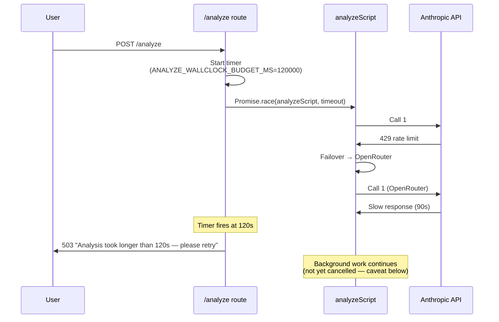

Honest caveat we documented in source: the dangling background work is **not** actually cancelled on timeout — we don't have `AbortSignal` threading through every AI SDK call yet. The benefit is bounded user wait time + faster failure signaling, **not** bounded token spend mid-flight.

Future hardening: thread `AbortController` through `runAgentLoop` so cancellation actually stops token spending.

Code: [`packages/orchestrator/src/lib/wallclock-budget.ts`](../packages/orchestrator/src/lib/wallclock-budget.ts) + `routes/analyze.ts` (PR #193).

---

## 12. Measurement — `llm_call_log`

Every cost-opt PR before #196 estimated savings with hand-wavy "~12× cheaper" or "estimated 60–70%". PR #196 ends the guesswork.

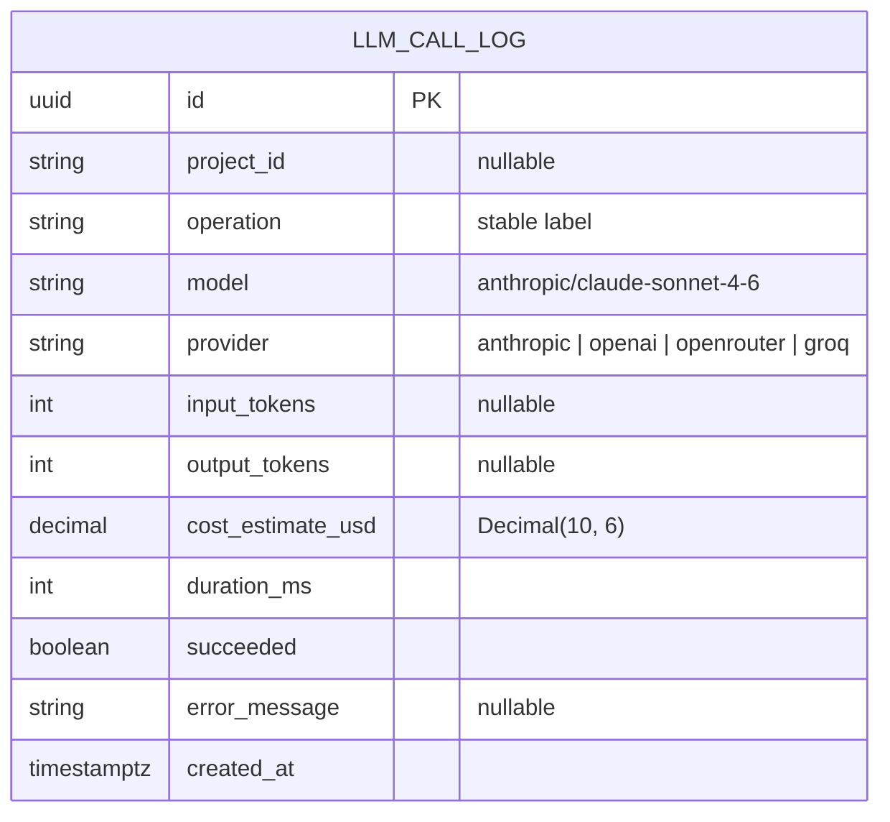

Three indexes (PR #196 migration 0037):

- `(project_id, created_at DESC)` — per-project cost rollups (most common query)
- `(operation, created_at DESC)` — per-operation aggregates
- `(created_at)` — time-range scans for retention

Writes are **fire-and-forget**: a DB failure logs at WARN and never propagates. The request that triggered the call still returns normally; only the log row is lost.

### Cost estimation

Cost is derived from a hardcoded `PRICING_USD_PER_MT` table keyed on model name. Unpriced models return $0 (deliberate undercount, not invented price):

```ts
const PRICING_USD_PER_MT: Record<string, { in: number; out: number }> = {
  'anthropic/claude-sonnet-4-6': { in: 3.0, out: 15.0 },
  'anthropic/claude-haiku-4-5': { in: 0.8, out: 4.0 },
  'anthropic/claude-opus-4-6': { in: 15.0, out: 75.0 },
  'openai/gpt-4.1': { in: 10.0, out: 30.0 },
  'openai/gpt-4o': { in: 5.0, out: 15.0 },
  // OpenRouter Claude variants approximated as upstream Anthropic
  'openrouter/anthropic/claude-sonnet-4-6': { in: 3.0, out: 15.0 },
  'groq/llama-3.3-70b-versatile': { in: 0.59, out: 0.79 },
};
```

### Practical queries

Once PR #196 ships, the answers we previously guessed at become SQL:

```sql
-- What did this script cost?
SELECT operation, model, COUNT(*) as calls, SUM(cost_estimate_usd) AS usd
FROM llm_call_log
WHERE project_id = $1 AND created_at > now() - interval '1 day'
GROUP BY operation, model
ORDER BY usd DESC;

-- Which operations are getting expensive?
SELECT operation, SUM(cost_estimate_usd) AS usd, AVG(duration_ms) AS p_avg_ms
FROM llm_call_log
WHERE created_at > now() - interval '7 days'
GROUP BY operation
ORDER BY usd DESC
LIMIT 10;

-- Are we hitting the OpenAI escape often?
SELECT date_trunc('hour', created_at) AS hour, provider, COUNT(*) AS calls
FROM llm_call_log
WHERE created_at > now() - interval '24 hours'
GROUP BY hour, provider
ORDER BY hour DESC;

-- Failure rate by model
SELECT model, COUNT(*) AS total,
       SUM(CASE WHEN NOT succeeded THEN 1 ELSE 0 END) AS failed,
       100.0 * SUM(CASE WHEN NOT succeeded THEN 1 ELSE 0 END) / COUNT(*) AS pct_failed
FROM llm_call_log
WHERE created_at > now() - interval '1 day'
GROUP BY model;
```

Code: [`packages/orchestrator/src/lib/llm-call-log.ts`](../packages/orchestrator/src/lib/llm-call-log.ts) (PR #196). Disable via `LLM_CALL_LOG_DISABLED=true`.

---

## 13. Defenses — Zod schema Anthropic guard

PR #178's symptom was Peter reporting "scoring fails on every script". Root cause: four separate schemas containing `.min(1).max(10)` on integer fields, each silently rejected by Anthropic's structured-output API. By the time it surfaced in testing, real tokens had been burned in retry storms.

The bug class: Anthropic's structured-output endpoint rejects JSON Schema constraints like `minimum`, `maximum`, `minLength`, `maxLength`, `minItems`, `maxItems`, `pattern`. The AI SDK translates Zod `.min()` / `.max()` / `.length()` / `.regex()` into exactly those JSON Schema constraints.

PR #197 added a unit test that **walks every Zod schema passed to `generateObject` and `generateStructuredOutput`** and fails CI if any contain forbidden constraints. The walker reads `_def` defensively and handles:

- `ZodString` checks (`.min`, `.max`, `.length`, `.regex`, `.startsWith`, `.endsWith`, `.includes`)
- `ZodNumber` checks (`.min`, `.max`, `.multipleOf`)
- `ZodArray` length constraints (`.min`, `.nonempty`, `.max`)
- `ZodObject` shapes (recursively walked)
- `ZodOptional`, `ZodNullable`, `ZodDefault`, `ZodReadonly`, `ZodEffects`, `ZodBranded` wrappers
- `ZodUnion`, `ZodDiscriminatedUnion`, `ZodIntersection`, `ZodRecord`

When a future schema edit reintroduces the pattern, the test fails with a clear path like `DirectorJSONSchema.scenes.<item>.dialogue.<item>.text: string.min` plus the fix instruction.

If you hit the test:
1. Remove the constraint from the schema (use `.describe()` to document intent)
2. Enforce the constraint server-side AFTER the LLM responds (see `assertHttpDirectorJSONInvariants` in `orchestrator/pipeline.ts` or `clampScore` in `analysis/script-score-service.ts`)

Code: [`packages/orchestrator/src/lib/zod-anthropic-guard.ts`](../packages/orchestrator/src/lib/zod-anthropic-guard.ts) + `.test.ts` (PR #197).

---

## 14. The compounding effect

The most important property of the 14-PR arc is that the layers **compound multiplicatively**, not additively. Consider a writer iterating on a 30-scene script where only scene 7 changed:

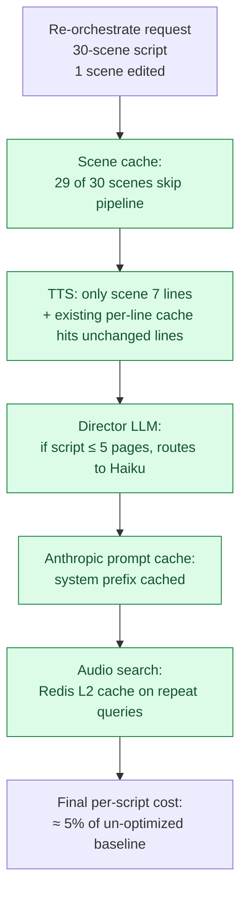

Each lever amplifies the others:

- Scene cache eliminates **scenes** of work.
- Per-line TTS cache eliminates **lines** within remaining scenes.
- Embedding cache eliminates **OpenAI calls** during audio search for those scenes.
- Prompt caching eliminates **token overhead** on each LLM call.
- Tiered model routing puts small scripts on **cheaper models** entirely.
- Haiku on voice + audio director provides another **12× drop** on their per-call rates.

For a real "I edited scene 7" iteration, the cost is *almost entirely the marginal work for scene 7*, not the script size.

---

## 15. Operating playbook

Every cost lever has an env-var disable switch so we can isolate issues fast:

| Lever | Disable flag | Use when |
|-------|-------------|----------|
| Anthropic prompt cache | `ENABLE_PROMPT_CACHE=false` | Debugging cache invalidation; running an A/B baseline |
| Scene cache | `SCENE_CACHE_DISABLED=true` | Debugging mix output; forcing fresh renders |
| Embedding L2 cache | `EMBEDDING_CACHE_DISABLED=true` | Catalog regeneration; staleness debugging |
| Tiered model routing | `TIER1_PAGE_THRESHOLD=0` | Forcing Sonnet on all scripts |
| Batched script-score | `BATCHED_SCORING_ENABLED=true` to enable | Default OFF until corpus A/B confirms quality |
| Groq Whisper | `ENABLE_GROQ_WHISPER_FALLBACK=false` | Suspected Groq quality regression |
| OpenAI Whisper | `ENABLE_OPENAI_WHISPER_FALLBACK=true` to enable | Critical alignment quality need; default off |
| Wall-clock budget | `ANALYZE_WALLCLOCK_BUDGET_MS=0` | Allow long-running analyses |
| LLM call log | `LLM_CALL_LOG_DISABLED=true` | Load testing without log noise |
| TEST_MODE | `TEST_MODE=mock` to enable | Free iteration loops (staging/dev only) |

### Model override env vars

| Var | Default | What it controls |
|-----|---------|------------------|
| `DIRECTOR_MODEL` | `anthropic/claude-sonnet-4-6` | Standard director pipeline + score |
| `DIRECTOR_MODEL_ADVANCED` | `anthropic/claude-opus-4-6` | Paid Advanced Analysis upgrade |
| `AUDIO_DIRECTOR_MODEL` | `anthropic/claude-haiku-4-5` | Audio cue selection |
| `VOICE_ASSIGNMENT_MODEL` | `anthropic/claude-haiku-4-5` | Voice assignment tool loop |
| `TIER1_MODEL` | `anthropic/claude-haiku-4-5` | Small-script routing target |
| `TIER1_PAGE_THRESHOLD` | `5` | Inclusive upper bound for tier 1 |
| `SCRIPT_SCORE_MODEL` | falls back to `DIRECTOR_MODEL` | Score-specific override |
| `GROQ_WHISPER_MODEL` | `whisper-large-v3` | Groq-side Whisper variant |

### API keys + their effect on chain shape

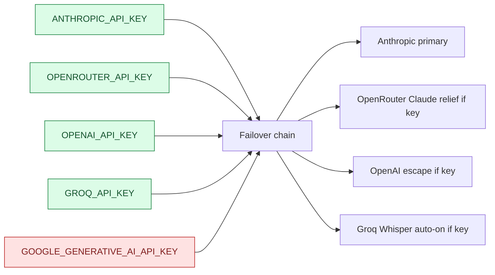

Practical rule: **ANTHROPIC + OPENROUTER + GROQ = the production set.** OPENAI is the escape hatch — set in Doppler, but flipping `ENABLE_OPENAI_WHISPER_FALLBACK` true is a separate decision. Google's key gates only the batch corpus scoring path, not the request hot path.

### When something looks expensive

1. **First, check `llm_call_log`** for which model + operation drove the spike.
2. **If the answer is OpenAI:** something is forcing the escape. Check Anthropic dashboard for outages.
3. **If the answer is Sonnet on small scripts:** verify `TIER1_PAGE_THRESHOLD` is set and the page-count estimator isn't off by much.
4. **If the answer is "lots of small calls":** check whether the scene cache is hitting (look for `[scene-cache] HIT` in orchestrator logs) and whether the prompt cache is hitting (look for non-zero `cacheReadInputTokens` in `providerMetadata`).
5. **If the answer is everything at once:** look at Peter's iteration loop. Is `TEST_MODE=mock` set in staging? Should it be?

---

## 16. Future levers

Things we've documented but haven't yet shipped:

| Lever | PR / status | Effort |
|-------|-------------|--------|
| Per-iteration token threading in `runAgentLoop` | Documented in PR #196 (currently logs timing + succeeded only) | 1 SP |
| AbortSignal propagation through AI SDK calls | Wall-clock budget caveat — would let timeout actually cancel | 3 SP |
| Streaming partial scenes | Not started — reliability play, not cost | 5 SP |
| Pipeline tables FK + UUID type fix (DT-31-H-1) | Sprint A — 2026-06-09 review HIGH finding | 3 SP |
| Smaller chunks for long scripts | Needs measurement (`llm_call_log` enables this) | 2 SP |
| Cross-project embedding cache reuse | `scene_renders.content_hash` index already in place; needs scope decision | 3 SP |
| Production cost dashboards | Depends on `llm_call_log` shipped first | 2 SP |
| Anthropic 1-hour cache TTL | Available in SDK — needs measurement of TTL hit rate to justify | 1 SP |

### Open architectural question

We use OpenRouter as a "same-model, different account" relief valve. The alternative would be **multiple Anthropic API keys** (e.g., production + staging-billed-separately). OpenRouter adds a small markup over upstream Anthropic but doesn't require splitting our Anthropic billing across multiple accounts. As long as our rate-limit ceiling at OpenRouter is higher than the spike pattern we want to absorb, OpenRouter is the right call.

If we ever hit OpenRouter rate limits as a steady-state, the answer is **adding a second Anthropic-direct key** (or escalating with Anthropic to raise our quota), not adding a third provider.

---

## Code references

| Topic | File |
|-------|------|
| LLM client + failover | `packages/orchestrator/src/lib/llm-client.ts` |
| Anthropic prompt cache | `packages/orchestrator/src/lib/llm-client.ts::buildSystemMessages` |
| Embedding cache | `packages/orchestrator/src/lib/embedding-cache.ts` |
| Embedding config + guard | `packages/orchestrator/src/lib/embedding-config.ts` |
| Scene cache | `packages/orchestrator/src/lib/scene-cache.ts` |
| Scene cache integration | `packages/orchestrator/src/orchestrator/pipeline.ts` (both `orchestrate` + `orchestrateParallel`) |
| Tiered model selection | `packages/orchestrator/src/lib/select-director-model.ts` |
| Whisper fallback | `packages/orchestrator/src/orchestrator/workers/whisper-align.ts` |
| TEST_MODE mock | `packages/orchestrator/src/lib/mock-provider.ts` |
| Wall-clock budget | `packages/orchestrator/src/lib/wallclock-budget.ts` |
| Cost attribution | `packages/orchestrator/src/lib/llm-call-log.ts` |
| Zod Anthropic guard | `packages/orchestrator/src/lib/zod-anthropic-guard.ts` |
| Pricing table | `packages/orchestrator/src/lib/llm-call-log.ts::PRICING_USD_PER_MT` |
| Model matrix doc | `docs/MODEL_MATRIX.md` |
| Phase 2 plan | `docs/COST-OPT-PLAN-2026-06-09.md` |

## PR cross-reference

| PR | Title | Layer |
|----|-------|-------|
| #178 | Stop dual-billing + Anthropic-safe schemas | Foundation |
| #179 | Voice-assignment → Haiku | Model matrix |
| #181 | Embeddings unified at 1536d | Embedding pipeline |
| #183 | Audio director → Haiku | Model matrix |
| #184 | Anthropic prompt caching | Cache layer |
| #185 | Batched script-score | Call shape |
| #187 | Redis L2 embedding cache | Cache layer |
| #188 | Tiered model selection | Model matrix |
| #189 | Groq Whisper fallback | Whisper chain |
| #191 | Scene-level cache (sequential) | Cache layer |
| #192 | Scene cache (parallel pipeline) | Cache layer |
| #193 | Wall-clock budget | Reliability |
| #194 | Proper OpenRouter relief valve | Failover chain |
| #195 | TEST_MODE mock | Iteration |
| #196 | LLM call log | Measurement |
| #197 | Zod-anthropic guard | Defense |
| #198 | Web Adviser → Claude | Provider unification |

---

*This primer is intended to stay current. When you ship a new cost-opt lever, add a section + update the relevant mermaid diagram. When a model price changes, update the `PRICING_USD_PER_MT` table and link the diff here.*
