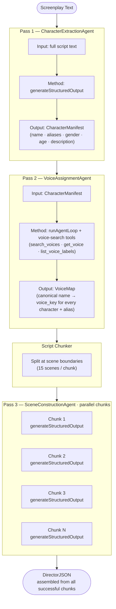

# Director Agent Architecture — Design Analysis & Evolution

**Date:** 2026-04-25  
**Author:** Chris Therriault  
**Status:** Production (multi-pass pipeline live as of 2026-04-25)

---

## Executive Summary

Story Magic's Director Agent converts raw screenplay text into structured `DirectorJSON` — the data contract that drives every downstream audio production step (TTS, timeline, mixing, export). This document traces the evolution from the original single-pass approach to the current three-pass multi-agent pipeline, explains the root causes of prior failures, documents the architectural decisions made, and summarizes all robustness and efficiency improvements applied in April 2026.

---

## Part 1 — The Original Architecture: Single-Pass Agent Loop

### How It Worked

The first generation Director Agent operated as a single, monolithic agent loop:

1. The full screenplay text was serialized into a JSON input object alongside a `project_id`
2. A single LLM call — with access to three voice-search tools (`search_voices`, `get_voice`, `list_voice_labels`) — was expected to do everything at once:
   - Read and understand the entire script
   - Identify every speaking character
   - Search ElevenLabs for appropriate voices for each character
   - Construct fully-attributed scenes with `voice_key` assignments for every dialogue line
   - Output a complete, valid `DirectorJSON` object
3. The result was parsed, repaired if malformed, and returned

The system prompt (`DIRECTOR_SYSTEM_PROMPT`, 357 lines) was exhaustive — detailing script abbreviations, voice search strategy, character arc guidance, JSON structure rules, and multi-point completeness checklists.

### Why It Failed

**The root cause was token budget exhaustion on real-world scripts.**

A 15-page screenplay generates approximately 7,500–12,000 tokens of input. A 90–120 page feature film generates 45,000–60,000 tokens of input. The model was asked to consume that input *and* produce a fully-structured JSON output in a single generation pass.

For a typical feature with 80 scenes and 15 characters, the required output was approximately:

```
80 scenes × 8 dialogue lines avg × ~120 tokens/line = ~76,800 output tokens
```

Most LLMs cap output at 8,192–16,384 tokens per generation. The model would begin generating valid JSON, hit the output limit, and stop mid-object. The downstream JSON parser would throw:

```
No JSON object found in input
```

Secondary failure modes:

| Failure | Cause |
|---------|-------|
| Voice duplication | Agent lost track of assigned voices in a long tool-calling context |
| Missing characters | Model's attention degraded over long context; minor characters dropped |
| Schema invalidation | Truncated JSON cascaded into validation failures; repair tools compounded cost |
| Cost overruns | 30-iteration agent loop at 32K tokens each = up to 960K tokens per failure |

### What Was Working

- The legacy fallback chain (JSON repair → `structureTextAsJSON` → `extractJSON`/`repairJSON`) was sophisticated and caught many partial failures
- The voice-search tool integration was solid — the right tools were available and functional
- The schema (`DirectorJSONSchema`) correctly defined the expected output contract

---

## Part 2 — The New Architecture: Three-Pass Multi-Agent Pipeline

### Design Principles

The redesign was guided by three constraints:

1. **No single LLM call should produce more than ~8,000 tokens of output.** Beyond this, truncation risk becomes significant regardless of model.
2. **Voice assignments must be stable before any scene is parsed.** In the single-pass approach, a character introduced late in the script might be assigned a different voice than earlier appearances. This is eliminated by separating voice assignment into its own dedicated pass.
3. **Failures should be partial, not total.** If one chunk of a 120-page script fails, the other 11 chunks should still succeed. The pipeline should degrade gracefully, not catastrophically.

### The Three Passes



---

### Pass 1 — CharacterExtractionAgent

**File:** `src/director/agents/character-extraction-agent.ts`  
**Method:** `generateStructuredOutput` (no tool calls, schema-enforced)  
**Output:** `CharacterManifest` — every speaking character with name, canonical name, aliases, gender, age, description, sample dialogue, and `is_narrator` flag

Key decisions:
- `temperature: 0` — character extraction is a deterministic parsing task, not a creative one
- `maxTokens: 8192` — character list output is compact; 8K is sufficient for 100+ characters
- The schema enforces a `characters` array at minimum; `project_id` is injected post-hoc if omitted by the model
- NARRATOR is always injected if absent — it is required downstream for scene descriptions

**Sanity check (added 2026-04-25):** After extraction, if character count is suspiciously low relative to script length (< 3 characters per 10,000 characters of script text, minimum 2), a warning is logged. This signals extraction failure without halting the pipeline.

---

### Pass 2 — VoiceAssignmentAgent

**File:** `src/director/agents/voice-assignment-agent.ts`  
**Method:** `runAgentLoop` with voice-search tools  
**Output:** `VoiceMap` — canonical character names mapped to `voice_key` entries, plus default voices for narrator/male/female fallback

Key decisions:
- This is the *only* pass that uses tool calls. Passes 1 and 3 use structured output exclusively.
- `resetUsedVoices()` is called before the loop, clearing the global voice assignment tracker
- The input is compact (character list, not full script), keeping tool call context tight
- Temperature lowered to `0.3` (was `0.5`) — voice assignment benefits from determinism
- Fallback chain: direct JSON parse → `structureTextAsJSON` → minimal hardcoded VoiceMap with defaults. The pipeline never throws on voice assignment failure; it degrades to defaults instead.

**Duplicate voice detection (added 2026-04-25):** After the VoiceMap is returned, all `voice_key` values across assignments are scanned for duplicates. Duplicates are logged as warnings, naming the conflicting characters, so they can be investigated. The pipeline continues — a duplicate voice is suboptimal but not a hard failure.

---

### Pass 3 — SceneConstructionAgent

**File:** `src/director/agents/scene-construction-agent.ts`  
**Method:** `generateStructuredOutput` per chunk, all chunks dispatched in parallel via `Promise.allSettled`  
**Output:** `Scene[]` — all scenes with `scene_id`, `dialogue[]`, `mood`, `intensity`, `character_name`, and `voice_key` per line

Key decisions:
- **No tool calls.** Voice keys are resolved from the VoiceMap, which is embedded directly into the system prompt as a lookup table. The model does not need to search.
- **Schema-enforced output** via Zod eliminates JSON repair entirely for this pass.
- **Chunk size: 15 scenes.** A 120-page feature with ~100 scenes produces 7 chunks. Each chunk outputs ~8,000–10,000 tokens, well within model limits.
- **`Promise.allSettled` parallelism** — all chunks are sent concurrently. A 100-scene script (7 chunks) runs in the time of the slowest single chunk, not 7× that.
- Failed chunks are logged with scene range and error, then skipped. If fewer than all chunks fail, the pipeline returns partial but useful results.
- Only when ALL chunks fail does the agent throw, triggering the director-level fallback.

**Token budget reduced (2026-04-25):** `maxTokens` reduced from 32,768 to 16,384. A 15-scene chunk realistically produces 8,000–10,000 tokens of JSON output. 16,384 provides 60%+ headroom without wasting API capacity.

---

### Fallback Architecture

```mermaid
flowchart TD
    START([process\(\)]) --> PIPELINE["3-pass pipeline\nPass 1 → Pass 2 → Pass 3"]
    PIPELINE -->|success| OK([return DirectorJSON])
    PIPELINE -->|any pass throws| LEGACY["legacyProcess\(\)\nsingle-pass fallback\n⚠ capped at 1 attempt"]
    LEGACY -->|success| OK
    LEGACY -->|failure| ERR([throw])
```

**Fallback cap (added 2026-04-25):** The legacy fallback is limited to **1 attempt**. Previously, `legacyProcess()` could run a 30-iteration agent loop at 32,768 tokens/iteration — a worst-case cost of ~960,000 tokens (~$3–4) per failure. The cap eliminates runaway cost on systematically bad input.

---

## Part 3 — Cross-Cutting Improvements (April 2026)

### 1. Consistent model routing through `structureTextAsJSON`

**File:** `src/lib/llm-client.ts`  
**Problem:** The `structureTextAsJSON` fallback function previously defaulted to `openai/gpt-4o-mini` regardless of the calling agent's model. A Director pipeline configured to use `claude-sonnet-4-6` would fall back to a weaker model mid-pipeline, producing inconsistent results and hidden cost discrepancies.  
**Fix:** `structureTextAsJSON` now requires its callers to pass a `model` parameter. Callers in `director-agent.ts` and `voice-assignment-agent.ts` now forward their configured model. The function still has a local fallback default (`openai/gpt-4.1`) for call sites outside the Director pipeline.

### 2. Duplicate voice detection in VoiceMap

**File:** `src/director/agents/voice-assignment-agent.ts`  
**Problem:** The voice assignment agent prompt instructed the model not to reuse voice keys, but there was no programmatic enforcement. Two characters could silently receive the same voice.  
**Fix:** After `addDefaults()` runs, all `voice_key` values in `assignments` are collected, duplicates are detected, and a structured warning log entry names every conflicting character pair. This surfaces the issue without halting production.

### 3. Character count sanity check

**File:** `src/director/agents/character-extraction-agent.ts`  
**Problem:** If character extraction silently under-extracted (e.g., model lost context on a long script), the pipeline would proceed with an incomplete manifest. Characters appearing in Pass 3 scenes but absent from the VoiceMap would silently receive default voices with no indication of the gap.  
**Fix:** A ratio check after extraction: if `characterCount < max(2, scriptLength / 10000 * 3)`, a warning is logged with the actual count, estimated minimum, and script length. Production monitoring can alert on this warning.

### 4. Reduced Pass 3 token budget

**File:** `src/director/agents/scene-construction-agent.ts`  
**Change:** `SCENE_CONSTRUCTION_MAX_TOKENS`: 32,768 → 16,384  
**Rationale:** Empirical analysis shows a 15-scene chunk produces 8,000–10,000 tokens of structured JSON output. 16,384 provides 60%+ headroom. The previous 32,768 was 3× what was needed — wasting API time and increasing per-request latency without benefit.  
**Expected savings:** ~$0.25–0.35 per 100-page script (roughly 25% reduction in Pass 3 cost).

### 5. Legacy fallback capped at 1 attempt

**File:** `src/director/agents/director-agent.ts`  
**Change:** The `catch` block in `process()` now calls `legacyProcess()` a maximum of 1 time and does not retry.  
**Rationale:** The primary purpose of the legacy fallback is to handle edge cases where the multi-pass pipeline encounters an unexpected structural failure. It is not designed to handle systematically bad input (e.g., a script with no scene headings, or a 200-page script). Unlimited retries through a 30-iteration agent loop created a path to $3–4 cost per processing attempt on bad input.

---

## Part 4 — Token & Cost Model

### Per-pass breakdown (100-page feature, ~80 scenes, 15 characters)

| Pass | Calls | Input Tokens | Output Tokens | Total | Notes |
|------|-------|-------------|--------------|-------|-------|
| Pass 1 — Character Extraction | 1 | ~30,000 | ~3,000 | ~33,000 | Full script in prompt |
| Pass 2 — Voice Assignment | 1 loop (~20 iterations) | ~8,000 | ~2,000 | ~10,000 | Tool calls bounded by character count |
| Pass 3 — Scene Construction | 6 chunks (parallel) | ~5,000/chunk | ~9,000/chunk | ~84,000 | Parallel; wall-clock = 1 chunk's time |
| Validation + assembly | — | — | — | ~1,000 | Schema checks, no LLM |
| **Total (success path)** | | | | **~128,000** | |
| Legacy fallback (if triggered) | 1–30 iterations | ~10,000/iter | ~32,768/iter | ~43,000–1,280,000 | **Capped at 1 attempt** |

### Cost at current pricing (OpenAI gpt-4.1, April 2026)
- **Success path:** ~$0.40–0.50 per 100-page script
- **With one legacy fallback:** ~$0.55–0.65
- **Old single-pass (worst case):** $3.00–4.00

### Wall-clock time
- **Pass 1:** ~15–25 seconds (full script analysis)
- **Pass 2:** ~30–60 seconds (tool call loop, 15–20 characters)
- **Pass 3:** ~20–35 seconds (6 parallel chunks, bottlenecked by slowest chunk)
- **Total:** ~65–120 seconds for a 100-page feature

---

## Part 5 — Known Limitations & Future Work

### Active Limitations

| Issue | Severity | Notes |
|-------|----------|-------|
| Pass 1 sends full script in one call | Medium | Works for 120-page scripts but approaches context limits for very long screenplays. Chunked extraction would be more robust but adds complexity. |
| Character alias detection is LLM-guided | Medium | If a character is referred to as "THE STRANGER" early and "FRANK" later, the model must infer they're the same person. Occasionally fails on complex reveals. |
| Voice search tool history grows per iteration | Low | Each tool call result is appended to message history in Pass 2, growing context cost. Bounded by character count (max ~50 iterations). |
| Default voices are hardcoded ElevenLabs IDs | Low | If ElevenLabs retires `JBFqnCBsd6RMkjVDRZzb` (George), the fallback breaks silently. Should be environment-variable configurable. |

### Planned Improvements (Backlog)

1. **Voice consistency enforcement** — same character always gets same voice across sessions, not just within a single pipeline run. Requires persisting VoiceMap per project.
2. **Chunked Pass 1** — split the script into 3–4 sections, extract characters in parallel, merge and deduplicate. Improves both speed and completeness for very long scripts.
3. **Batch voice search** — query voices for 3–5 characters per tool call rather than one at a time. Reduces Pass 2 token consumption ~70%.
4. **Configurable default voices** — move hardcoded ElevenLabs IDs to environment variables or a project-level voice configuration.
5. **Character deduplication via embedding similarity** — detect canonical character names that are likely aliases using vector similarity rather than prompt instruction.

---

## Appendix A — File Map

| File | Role |
|------|------|
| `src/director/agents/director-agent.ts` | Pipeline orchestrator; fallback logic |
| `src/director/agents/character-extraction-agent.ts` | Pass 1 |
| `src/director/agents/voice-assignment-agent.ts` | Pass 2 |
| `src/director/agents/scene-construction-agent.ts` | Pass 3 |
| `src/director/prompts/character-extraction-prompt.ts` | Pass 1 system prompt |
| `src/director/prompts/voice-assignment-prompt.ts` | Pass 2 system prompt + user message builder |
| `src/director/prompts/scene-construction-prompt.ts` | Pass 3 system prompt (with VoiceMap table) + user message builder |
| `src/director/prompts/director-prompt.ts` | Legacy single-pass system prompt (fallback only) |
| `src/director/utils/script-chunker.ts` | Scene boundary detection and chunking |
| `src/schemas/character-manifest.ts` | Zod schema for Pass 1 output |
| `src/schemas/voice-map.ts` | Zod schema for Pass 2 output + `lookupVoice()` utility |
| `src/schemas/director-json.ts` | Zod schema for final DirectorJSON output |
| `src/lib/llm-client.ts` | Multi-provider LLM abstraction (generateStructuredOutput, runAgentLoop, structureTextAsJSON) |

---

## Appendix B — Test Coverage

| File | Tests | Coverage |
|------|-------|----------|
| `script-chunker.test.ts` | 15 | extractSceneInfo, chunkScript, countScenes |
| `character-extraction-agent.test.ts` | 6 | happy path, missing project_id, missing NARRATOR, schema failure, model forwarding, sanity check |
| `voice-assignment-agent.test.ts` | 6 | happy path, resetUsedVoices, parse fallback, all-failure fallback, agent loop failure, missing defaults |
| `scene-construction-agent.test.ts` | 6 | happy path, multi-chunk ordering, partial failure, all-failure, chunk count, model forwarding |
| `director-agent.test.ts` | 15 | 3-pass orchestration, pass ordering, model forwarding, scenesPerChunk, fallback trigger, VoiceMap forwarding, all legacyProcess variants, all run() variants |
| **Total** | **48** | All passing |
