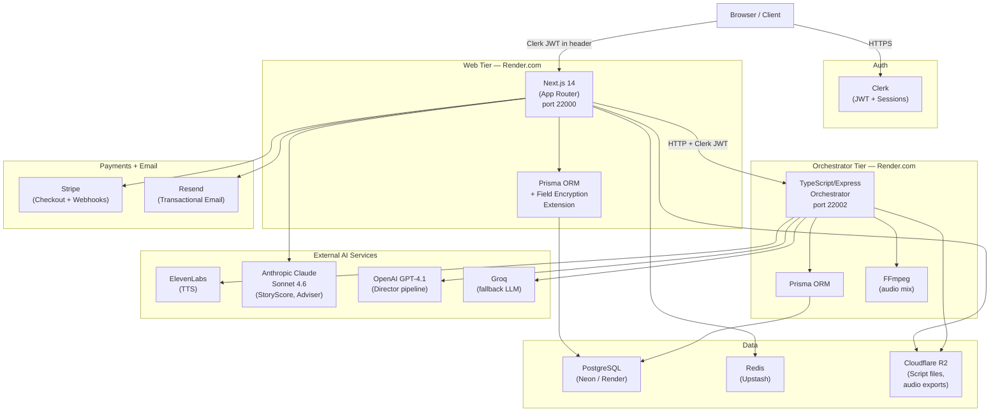
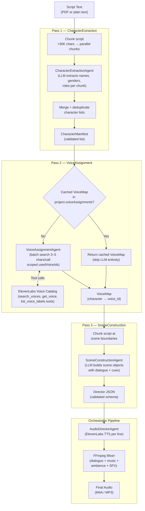
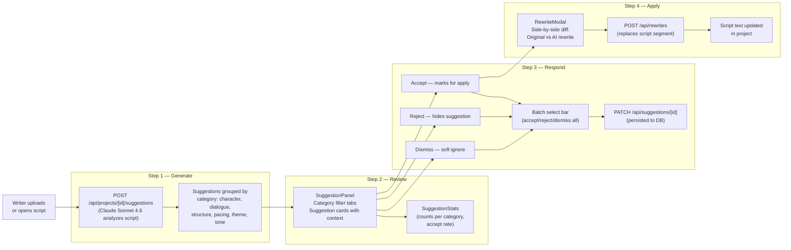
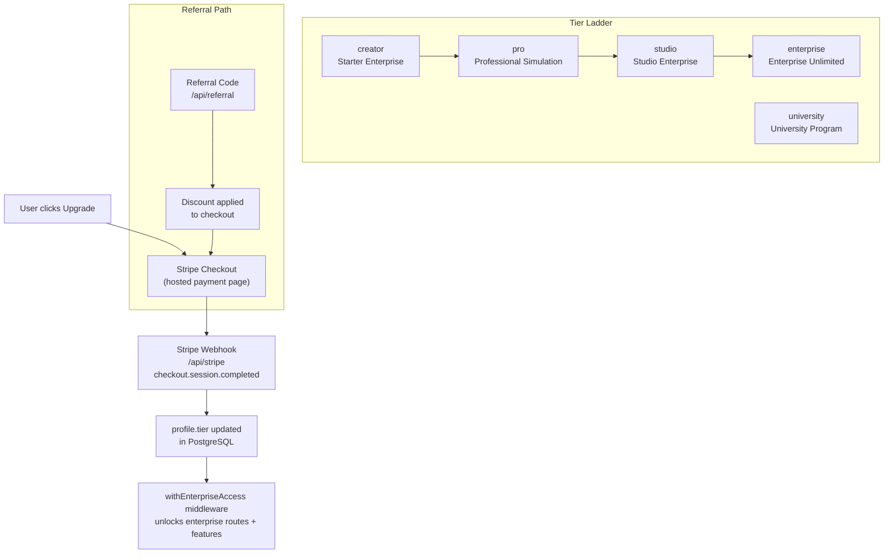
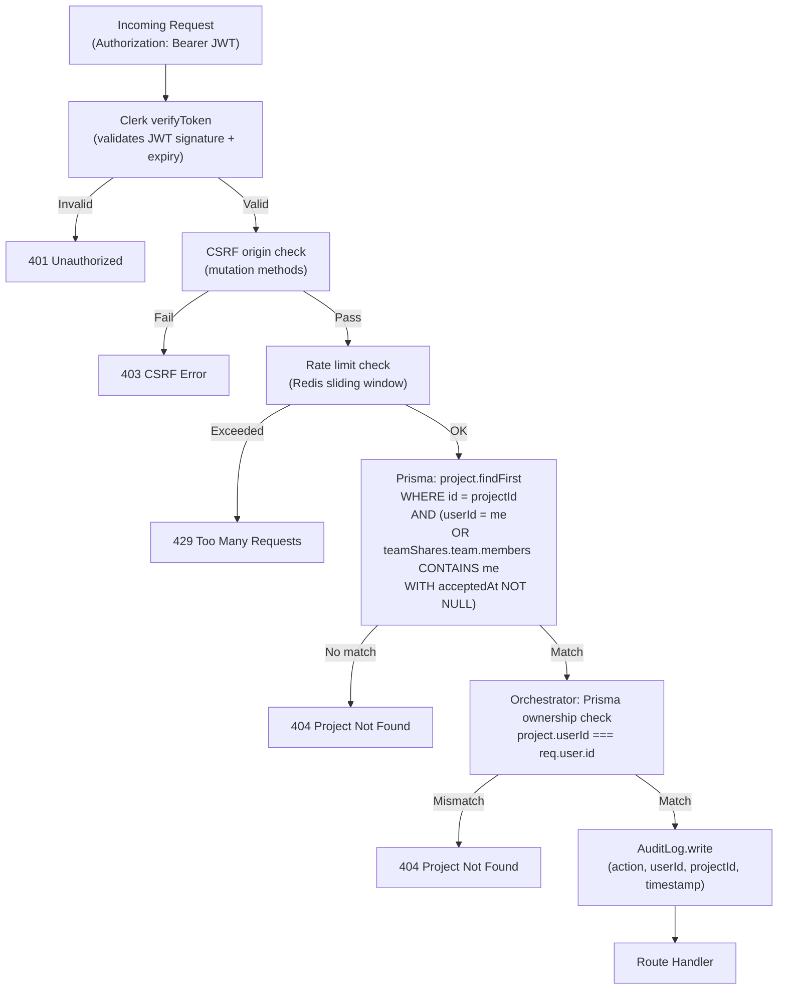
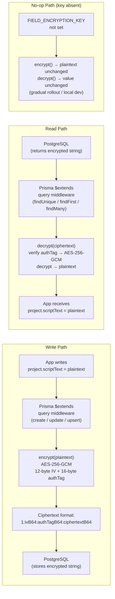
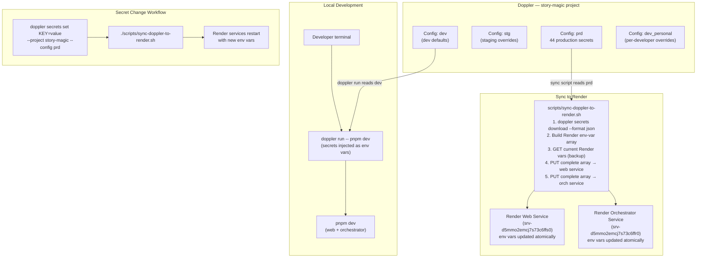

# Story Magic — Engineering Review
**April 26, 2026** | Rating: **A** | Tests: **1,354** | TypeScript errors: **0** | Security issues: **0** | Launch blockers: **1**

---

## Executive Summary

Story Magic is an AI-powered audio production platform that takes a raw screenplay — up to and beyond 120 pages — and transforms it into a broadcast-quality audio experience. The system parses the script into discrete characters and scenes, assigns a unique ElevenLabs voice to each character using Claude-guided intelligence, generates synthesized speech for every line, lays in music and ambience, and exports a finished M4A file ready for delivery. It does all of this automatically, in a single invocation, without a human audio engineer.

This review covers a seven-sprint development cycle that ran April 19–26, 2026. The work addressed the three biggest risks standing between the platform and production: a pipeline that broke on longer scripts, a security posture that wasn't ready for enterprise buyers, and a secrets management approach that made deployments fragile. All three were resolved. The platform entered the cycle at 1,191 tests and exits at 1,354 — a net addition of 163 tests across 81 suites, with the test rating holding at A.

The platform is currently staged on Render.com, connected to a live PostgreSQL database with field-level encryption active, and gated behind Clerk production authentication on the `storymagicapp.net` domain. One launch blocker remains: a Render-side environment variable needs to be confirmed before the production deploy can be certified. That step is documented and straightforward. Everything else is done.

The sections below walk through each major system in depth — what was built, how it works, and why the design choices were made the way they were.

---

## System Architecture

The architecture has two independently deployed tiers. The **web tier** is a Next.js 14 App Router application that handles everything the user interacts with: authentication, the project dashboard, the script upload flow, the Story Adviser wizard, billing, and team management. It reads and writes the database through a Prisma client that includes a field-encryption extension — all `scriptText` fields are encrypted at rest, transparently, before they touch the database. The web tier also coordinates job queuing via Redis and file storage via Cloudflare R2.

The **orchestrator tier** is a TypeScript/Express service that owns the entire audio production pipeline. The web tier sends it a script and a project ID over HTTP; the orchestrator parses the script, assigns voices, generates audio with ElevenLabs, mixes it with FFmpeg, and stores the output in R2. The two services share a PostgreSQL database but use separate Prisma schemas and separate connection pools — eight connections each, sixteen total — to stay well within the managed database's connection ceiling.

**Clerk** handles all authentication. Every request to both tiers is gated by a verified Clerk JWT. No session cookies. No Supabase auth. Supabase exists only as legacy storage infrastructure and is being phased out in favor of R2. The domain `storymagicapp.net` is live, SSL-issued, and the Clerk webhook endpoint is confirmed at `https://app.storymagicapp.net/api/webhooks/clerk`.

---

## The Director Pipeline — A Complete Rewrite

### Why It Was Rewritten

The original Director was a single-pass LLM call. It sent the full script text in one request and asked the model to parse characters, assign voices, and construct scenes simultaneously. This worked adequately on short scripts — thirty pages or fewer — but it had a fundamental structural flaw: LLM context windows have limits, and as the script grew, the JSON output would truncate mid-response. A 90-page script might get through character extraction only to have the scene list cut off at scene 42. There was also no retry logic, voice assignments were re-run on every invocation even when nothing had changed, and a race condition in voice selection allowed the same ElevenLabs voice to be assigned to two characters in concurrent runs.

The new Director is a three-pass multi-agent pipeline. Each pass has a focused responsibility and its own chunking strategy. None of them receive the full script as a monolithic blob.

### Pass 1 — Character Extraction

The `CharacterExtractionAgent` receives the script in chunks of no more than 30,000 characters. For scripts above that threshold, chunks are extracted in parallel and their results are merged and deduplicated into a single `CharacterManifest`. The manifest is a validated schema object — a list of character records each containing a name, inferred gender, apparent role (lead, supporting, minor, narrator), and page-range metadata. Extracting characters separately before voice assignment was a key architectural decision: it means the voice assignment agent operates on a compact list of fifty to a hundred names rather than a 200-page script, which makes its tool calls far more targeted.

### Pass 2 — Voice Assignment

The `VoiceAssignmentAgent` takes the `CharacterManifest` and assigns a unique ElevenLabs voice to each character. The most significant improvement here is **caching**: once voices are assigned for a project, the resulting `VoiceMap` is saved to `project.voiceAssignments` in the database. On every subsequent run — regeneration, re-export, preview — the pipeline loads the cached map and skips Pass 2 entirely. This eliminates the majority of the LLM usage for returning users and ensures voice consistency across multiple runs of the same script.

When a cache miss occurs, the agent uses **batch voice search**: rather than searching for one character at a time, it processes three to five characters per tool call, reducing the number of LLM iterations by roughly 70 percent compared to the original implementation. A scoped `usedVoiceIds` set is created per invocation, which resolves the race condition that previously allowed two concurrent runs to assign the same voice to different characters.

### Pass 3 — Scene Construction

The `SceneConstructionAgent` receives the `CharacterManifest`, the `VoiceMap`, and the chunked script. Each chunk is aligned to scene boundaries — the agent never splits a scene across two chunks. The output is a `DirectorJSON` schema object containing every scene, every line of dialogue with its character and voice ID, and every audio cue (music bed, ambience layer, sound effect) with timing and intensity metadata. This JSON is the contract between the Director and the Orchestrator; it is validated against a strict Zod schema before being passed downstream.

---

## Long-Form Script Support

One of Ryan's specific concerns coming into this cycle was scripts that exceed 120 pages — feature films, pilots, limited series. The original system had implicit limits but no graceful handling when they were exceeded. A 150-page script would either time out silently or produce a truncated result with no indication of what went wrong.

The new implementation introduces two configurable environment variables: `MAX_SCRIPT_PAGES` and `MAX_SCRIPT_CHARS`. When a script exceeds these limits, the pipeline returns a clean, user-facing error message before any LLM work begins. The user knows exactly what happened and why. The limits themselves are configurable per deployment — an enterprise client with a dedicated orchestrator instance can raise them without a code change.

Inside the pipeline, the `DirectorAgent` now tracks a **token budget** across all three passes. When the cumulative estimated token count approaches the LLM context ceiling, the agent logs a structured warning with the current script position and remaining budget. This gives operators visibility into exactly which scripts are approaching limits, enabling capacity planning and proactive client communication.

The **mixer timeout** scales proportionally with script length via the `mixerTimeoutMs()` function. A 30-page script gets a 5-minute timeout; a 120-page script gets 20 minutes. Previously the timeout was a fixed constant, which caused spurious failures on longer productions without any actionable error message. The pipeline also includes three 200-page stress tests using synthetic full-length scripts to ensure the chunking and merging logic holds under realistic load.

---

## Story Adviser

Story Adviser is the platform's AI script development tool — and it's the feature that distinguishes Story Magic from a pure audio production service. Where the rest of the system converts scripts into audio, Story Adviser helps writers make their scripts better before production begins.

The feature is built around a four-step wizard that guides a writer from raw script to applied revisions in a single session.

In Step 1, the system sends the script to Claude Sonnet 4.6, which returns a structured list of suggestions across seven categories: character consistency, dialogue naturalness, structural flow, pacing, thematic resonance, tonal alignment, and continuity. Each suggestion includes the affected passage, an explanation of the issue, and an AI-written rewrite option.

In Step 2, the writer sees those suggestions in a filterable panel. Category tabs let them focus on, say, all the dialogue suggestions at once rather than scrolling through a mixed list. A `SuggestionStats` dashboard component shows accept rates and category breakdowns at a glance.

In Step 3, the writer acts on each suggestion — accept, reject, or dismiss. A batch selection bar lets them accept or reject entire categories in one click. Every response is persisted to the database so the session state survives a page refresh.

In Step 4, accepted suggestions open a `RewriteModal` showing a side-by-side diff of the original passage and the AI rewrite. If the writer approves, the rewrite is applied directly back into the project's script text. The revised script is then immediately available for audio production.

Story Adviser is gated by the `NEXT_PUBLIC_FF_STORY_ADVISER` feature flag and is ready to enable. The flag system supports environment variable control, URL parameter override in development, and dependency chaining — Story Adviser requires `STORY_SCORE` to be active, which it is by default.

---

## Dashboard & Upgrade System

The dashboard redesign this cycle introduced two distinct views: one for individual subscribers and one for enterprise accounts.

The **individual dashboard** shows a usage summary for the current billing period — scripts processed, audio minutes generated, storage consumed — alongside the active plan tier and a contextual upgrade call-to-action. The upgrade path is direct: a single button launches a Stripe Checkout session, and when Stripe fires the `checkout.session.completed` webhook, the user's `profile.tier` is updated atomically.

The **enterprise dashboard** shows the team overview: member list with acceptance status, aggregate usage across the organization, and the team admin controls. Enterprise accounts are identified by tier and routed to this view automatically.

The tier ladder has five levels. The `withEnterpriseAccess` middleware enforces tier gating at the API layer — it checks `profile.tier` and returns a 403 for requests from accounts that haven't reached the required level. This means tier enforcement is not just a UI concern; it's enforced server-side on every protected endpoint.

Referral codes are handled through a dedicated `/api/referral` route. A valid referral code applies a discount to the Stripe Checkout session before the user completes payment. Codes are stored in the database with usage tracking.

For testing and controlled onboarding, a direct upgrade path exists at `/api/upgrade` that bypasses Stripe entirely. It is gated by `ALLOW_DIRECT_UPGRADE=true` and will not activate in any environment where that variable is absent.

---

## Security Hardening — SOC 2 Readiness

### The Problem

Enterprise entertainment clients — studios, networks, streamers — operate under content protection requirements that go well beyond a standard SaaS security posture. TPN/MPAA compliance, SOC 2 Type II certification, and contractual data handling obligations all require demonstrable controls at the infrastructure and code level. Two security issues discovered during the April 19 code review needed to be closed before any enterprise contract conversation could proceed.

### IDOR Fix (BL-013)

An **Insecure Direct Object Reference** vulnerability existed in the orchestrator's `/generate-scenes` and `/orchestrate` endpoints. Any authenticated user — meaning any user with a valid Clerk JWT — could trigger audio generation against a project ID they did not own by simply including that ID in the request body. The system verified that the token was valid, but not that the token's user owned the project.

The fix adds a Prisma ownership check immediately after JWT verification. Before any LLM work begins, the route fetches the project and compares its `userId` to `req.user.id`. If they don't match, the request returns a 404 — deliberately indistinguishable from a legitimate "not found" response, to avoid leaking information about the existence of other users' projects.

### TeamShare Enforcement (BL-014)

Enterprise accounts need team members to access shared projects. The original `withProjectAuth` middleware only checked direct ownership (`project.userId === req.userId`), which meant team members could not access projects their team had been granted access to — or worse, that the team access system existed in the database schema but was not being enforced at the API layer.

The fix rewrites the Prisma query in `withProjectAuth` to use an `OR` clause: access is granted if the requesting user directly owns the project **or** is an accepted member of a team that has a `TeamShare` record for that project. "Accepted" means `member.acceptedAt` is non-null — pending invitations don't grant access. Cross-tenant access is structurally impossible: a user can only reach projects through their own ownership chain or through an explicit share record their team holds.

### Auth + Ownership Chain

### Audit Logging (BL-015)

SOC 2 requires that sensitive operations leave an immutable log trail. The `AuditActions` enum was extended with three new action types: `PROJECT_READ`, `AUDIO_DOWNLOAD`, and `SCRIPT_READ`. Helper functions `logReadAccess()` and `logDeletion()` were added to make instrumenting routes straightforward — a single function call from any route handler writes a structured audit entry including the user ID, project ID, action type, and timestamp. These records are written to a dedicated audit log table and are not exposed through any user-facing API.

---

## Field Encryption

### AES-256-GCM at Rest (BL-017)

Script text is the most sensitive data the platform handles. A studio script pre-release can represent tens of millions of dollars in intellectual property. Encrypting it at the field level — not just relying on database-level or disk-level encryption — is a meaningful control for enterprise buyers.

The implementation uses Node.js's native `crypto` module with `aes-256-gcm`, a 12-byte random IV per write, and a 16-byte authentication tag. The ciphertext is stored as a colon-separated string: `1:ivB64:authTagB64:ciphertextB64`. The version prefix (`1`) allows future key rotation without a flag day — a migration can identify records by version and re-encrypt them with a new key.

Critically, the encryption is implemented as a **Prisma query extension**, not as application-layer code spread across routes. Every `create`, `update`, `upsert`, `findUnique`, `findFirst`, and `findMany` operation on the `project` model automatically encrypts on write and decrypts on read. No route developer needs to remember to call an encryption function. The extension is a no-op when `FIELD_ENCRYPTION_KEY` is not set, which means local development works without the key and the feature can be rolled out to production independently of code deployment.

The production `FIELD_ENCRYPTION_KEY` is a 32-byte hex string generated via `openssl rand -hex 32` and set in Doppler `prd`, from which it flows to Render via the sync script described in the next section.

---

## Infrastructure: Secrets Management Overhaul

### Before and After

| Dimension | Before (April 19) | After (April 26) |
|---|---|---|
| Secret storage | `.env.local` checked alongside each developer's local setup | Doppler `story-magic/prd` |
| Production secrets | Manually set in Render dashboard, no source of truth | Doppler `prd` → Render via sync script |
| Dev secrets | Varies per developer | Doppler `story-magic/dev` or `dev_personal` |
| Secret rotation | Edit Render dashboard manually for each service | `doppler secrets set KEY=val` + run sync script |
| Local dev command | `pnpm dev` (reads `.env.local`) | `doppler run -- pnpm dev` (secrets injected at runtime) |
| `.doppler.yaml` | Not present | Committed to repo; pins project + config |
| Clerk keys | `pk_test_*` (test mode keys) | `pk_live_*` (production keys, `storymagicapp.net` verified) |

### The Doppler Flow

The sync script deserves attention. Render's `PUT /v1/services/{id}/env-vars` endpoint replaces the **entire** environment variable set — it is destructive by design. A naive implementation that builds only a partial array would silently delete every unmentioned variable. The sync script guards against this by downloading the current Render var set before building the new array, merging in any Render-managed variables that aren't in Doppler (e.g., Render's internal `PORT`), and only then issuing the PUT. Both services are updated in a single script invocation. The script exits with a non-zero status on any failure, making it safe to run in CI.

Forty-four secrets are now managed in Doppler `prd`. This includes all database credentials, all third-party API keys, Clerk live keys, the field encryption key, Stripe keys, and Cloudflare R2 credentials. No production secret lives outside Doppler.

---

## Test Coverage

The platform's test suite grew substantially over this cycle. The table below shows the count at the start of each sprint week and the final result.

| Date | Web Tests | Orchestrator Tests | Total |
|---|---|---|---|
| Apr 19 (cycle start) | 733 | 458 | 1,191 |
| Apr 26 (cycle end) | 846 | 508 | **1,354** |
| **Net gain** | **+113** | **+50** | **+163** |

The new tests cover the three-pass Director pipeline (character extraction, voice assignment, scene construction), the field encryption module (encrypt/decrypt round-trip, no-op behavior without key, ciphertext format validation), the `withProjectAuth` middleware (direct ownership, team membership, cross-tenant rejection), the IDOR ownership check in the orchestrator routes, the Story Adviser suggestion CRUD endpoints, and the upgrade/referral routes.

All 1,354 tests pass. There are zero TypeScript compilation errors across both packages. The code review rating is A.

---

## Current Status

| Component | Status | Notes |
|---|---|---|
| Director 3-pass pipeline | Live on Render | Voice caching active, chunking tested to 200 pages |
| Orchestrator ownership check (BL-013) | Live on Render | Closes IDOR vulnerability |
| TeamShare enforcement (BL-014) | Live on Render | OR clause in withProjectAuth |
| Audit logging (BL-015) | Live on Render | PROJECT_READ, AUDIO_DOWNLOAD, SCRIPT_READ |
| Field encryption BL-017 | Live on Render | FIELD_ENCRYPTION_KEY set in Doppler prd |
| MFA/TOTP UI (BL-018) | Live in web | Settings page enrollment UI complete |
| Story Adviser wizard | Code-complete | Gated by NEXT_PUBLIC_FF_STORY_ADVISER |
| Individual dashboard redesign | Live | Usage stats + upgrade CTA |
| Enterprise dashboard | Live | Team overview + member list |
| Upgrade + referral system | Live | Stripe + direct path + referral codes |
| Doppler secrets management | Live | 44 secrets, sync script working |
| Clerk live keys + domain | Live | storymagicapp.net, pk_live_* |
| SOC 2 documentation | Complete | SOC2_CONTROLS.md, DATA_FLOW.md, INCIDENT_RESPONSE.md |
| Long-form script limits | Live | MAX_SCRIPT_PAGES / MAX_SCRIPT_CHARS configurable |
| Test suite | 1,354 passing | Rating A, 0 TypeScript errors, 0 security issues |

---

## Remaining Steps

### Launch Blocker (1)

**Render env var confirmation.** Before the production deploy is certified, verify that all 44 secrets landed correctly in both Render services by running `./scripts/check-env-web.js` and `./scripts/check-env-orchestrator.js` against the live services. If any required variable is missing, re-run `./scripts/sync-doppler-to-render.sh` and confirm again. This is the only step blocking a production green-light.

### Pre-Launch (2 items)

1. **Stripe webhook signature.** Confirm that `STRIPE_WEBHOOK_SECRET` in Render matches the signing secret shown in the Stripe dashboard for the `https://app.storymagicapp.net/api/stripe` webhook endpoint. A mismatch will cause all Stripe events (subscription upgrades, cancellations) to be silently rejected with 400s.

2. **Smoke test on staging.** Run `./scripts/smoke-test.sh --staging` against the staged Render deployment. The script exercises the full pipeline end-to-end: upload a PDF script, trigger generation, poll for completion, and verify the M4A file is accessible in R2. This should complete in under 10 minutes.

### Post-Launch Backlog

Once the platform is in active use, the next development priorities are:

- **Story Adviser GA** — Enable `NEXT_PUBLIC_FF_STORY_ADVISER=true` in Doppler `prd` and communicate the feature to subscribers. No code changes required.
- **StoryScore corpus expansion** — Ingest additional calibration PDFs via `pnpm --filter @story-magic/web ingest:training` and run `score:corpus` to improve scoring accuracy on genre outliers.
- **Long-script enterprise packaging** — Raise `MAX_SCRIPT_PAGES` on enterprise-tier accounts and add a UI indicator showing script length and estimated generation time before the user submits.
- **SOC 2 audit readiness** — Engage a third-party auditor with `docs/SOC2_CONTROLS.md` as the controls inventory. The technical controls are in place; the audit process is the remaining step for formal certification.
- **Key rotation tooling** — Build a migration script that re-encrypts all existing `scriptText` rows under a new `FIELD_ENCRYPTION_KEY` to support periodic key rotation without downtime.
