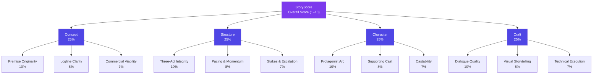
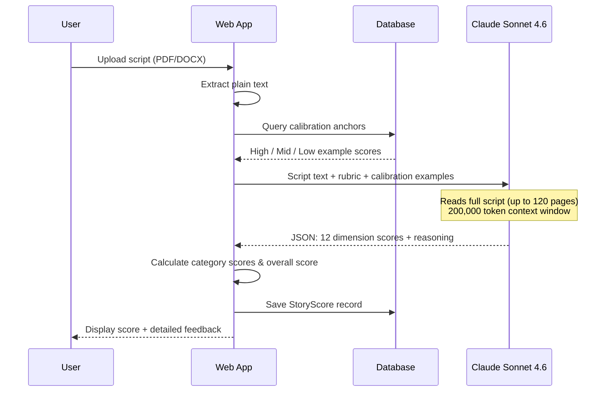
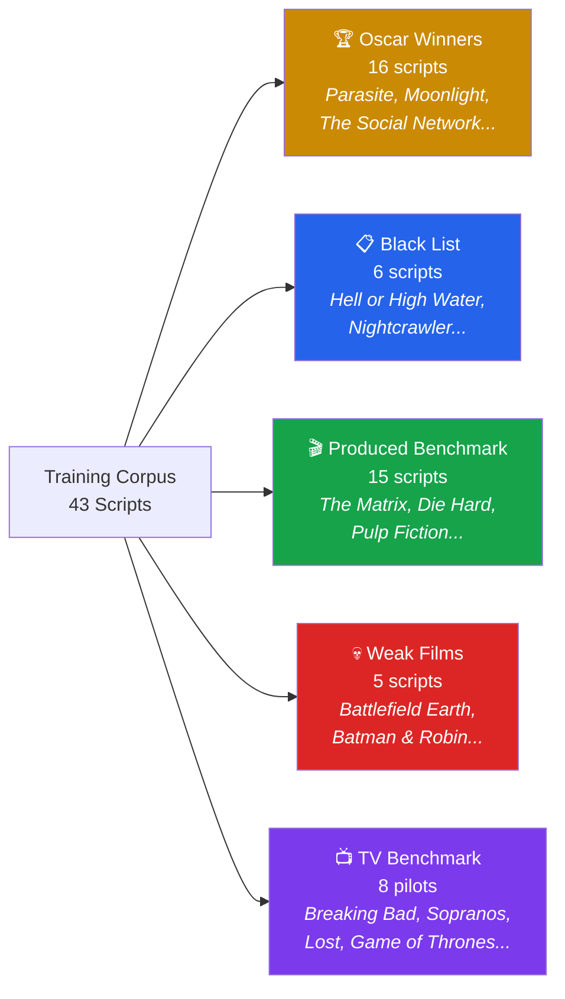
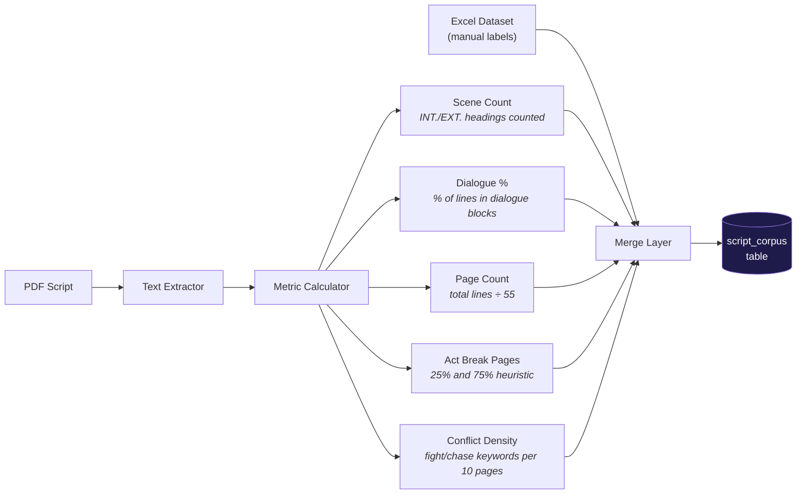
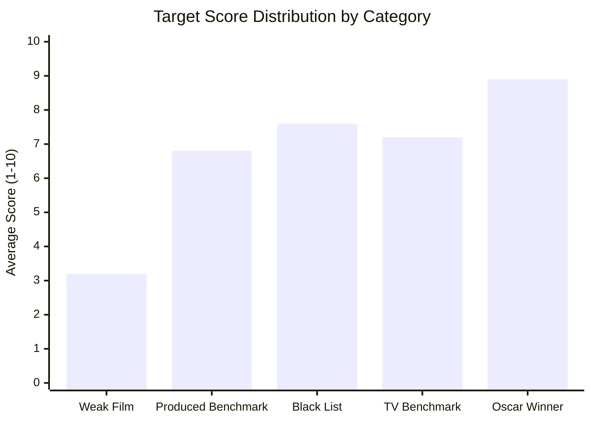
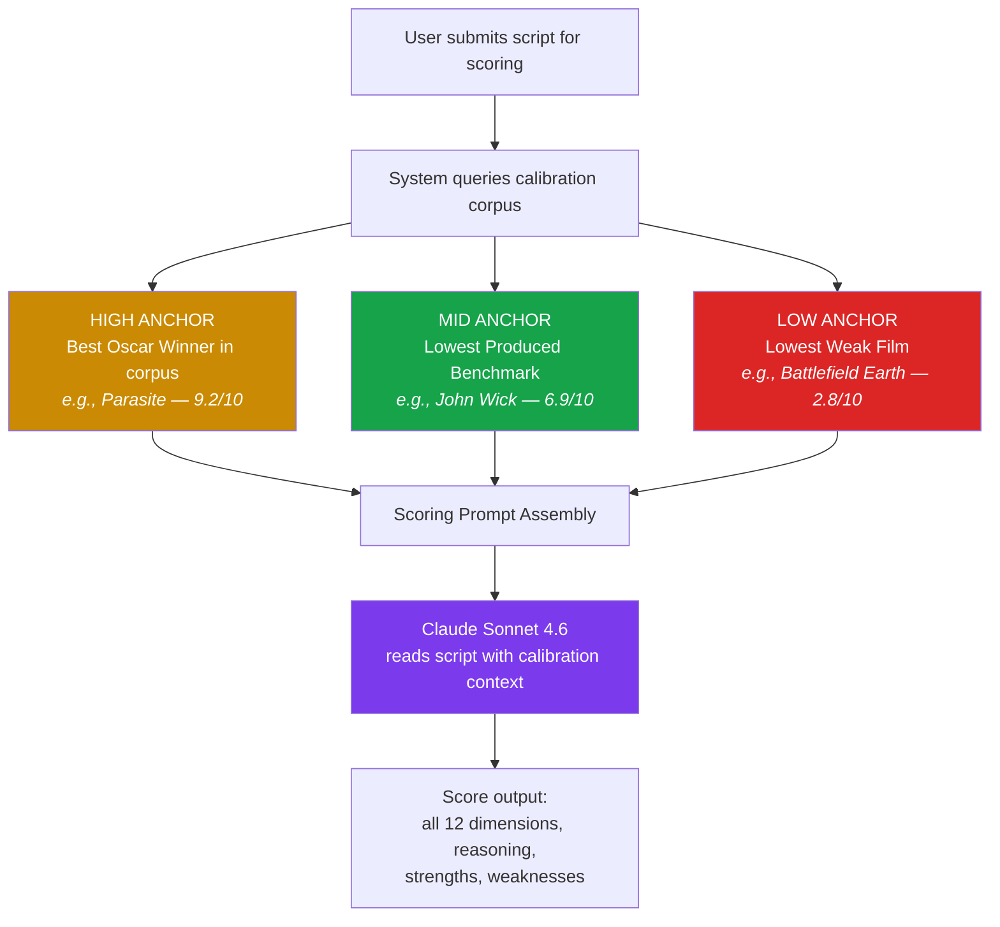
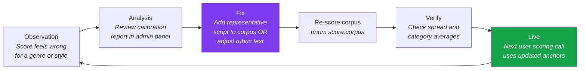
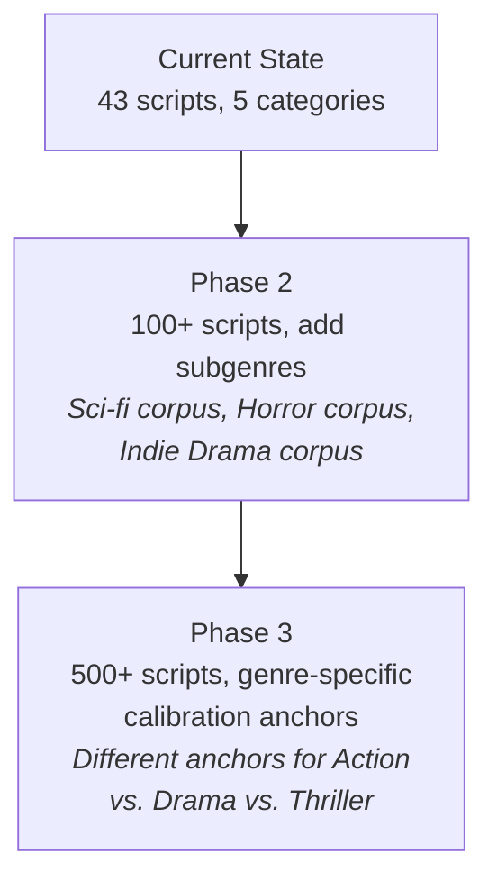
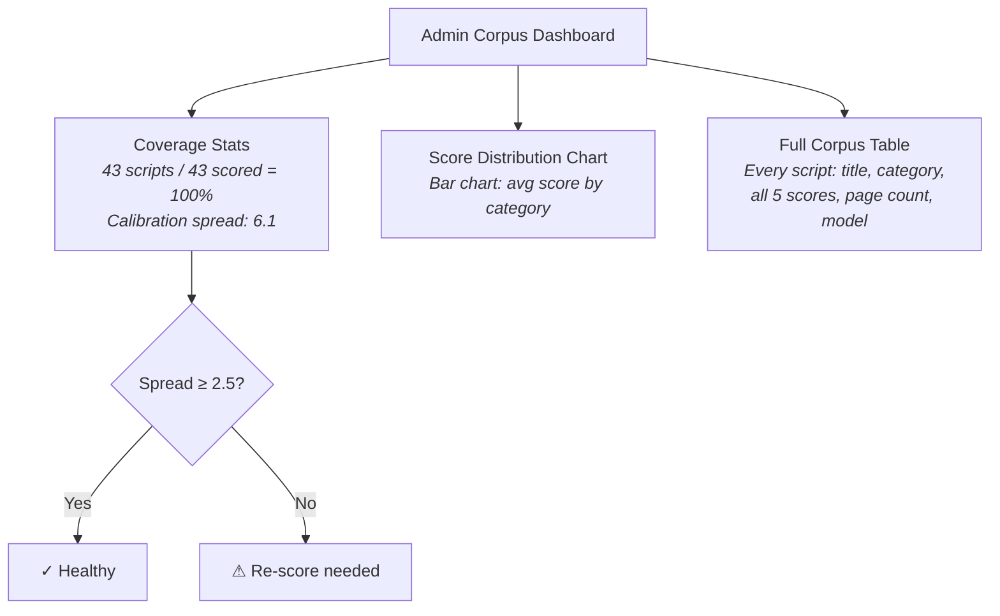
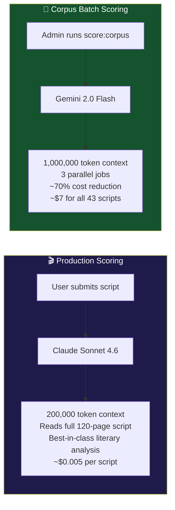

# StoryScore: How It Works

**Audience:** Product & Business
**Last Updated:** March 2026

---

## What Is StoryScore?

StoryScore is Story Magic's AI-powered screenplay evaluation engine. It reads a full script and produces a structured, multi-dimensional score — the same kind of assessment a professional Hollywood script reader would write, but delivered in seconds rather than days.

Every script a user uploads receives a StoryScore. The score tells the writer not just *how good* their script is, but *where* it's strong, *where* it needs work, and *why* — backed by specific references to scenes, characters, and pages.

The score is not a marketing feature. It is the core intelligence product that differentiates Story Magic from every other audio production tool on the market.

---

## Part 1: The Scoring Framework

### Four Pillars, Twelve Dimensions

Hollywood script coverage has always organized feedback into craft categories. StoryScore formalizes this into four pillars, each worth exactly 25% of the total score. Every pillar contains three dimensions. Every dimension is scored 1–10.

Within each pillar, the three dimensions are weighted slightly differently — the most impactful dimension carries 40% of the pillar weight, the second 32%, and the third 28%. This reflects real industry consensus: originality matters more than logline polish, structure integrity matters more than pacing tightening.

### What Each Dimension Measures

| Pillar | Dimension | What the AI is looking for |
|--------|-----------|---------------------------|
| **Concept** | Premise Originality | Is this story genuinely fresh, or a retread? Would a studio exec say "I've never seen this before"? |
| | Logline Clarity | Can the entire movie be pitched in one sentence? Is the protagonist, goal, and obstacle immediately clear? |
| | Commercial Viability | Who is the audience? How large is it? What comparable films succeeded? Is there franchise potential? |
| **Structure** | Three-Act Integrity | Do the turning points land? Does Act 2 have a strong midpoint? Does the climax feel earned? |
| | Pacing & Momentum | Does every scene earn its place? Does the reader want to turn the page? Are there slow patches? |
| | Stakes & Escalation | Do the consequences grow? Is the clock ticking? Does the protagonist have something real to lose? |
| **Character** | Protagonist Arc | Does the lead have a clear want and need? Do they change? Is there an internal and external journey? |
| | Supporting Cast | Is the antagonist three-dimensional? Do supporting characters have their own agendas? |
| | Castability | Are these roles actors would fight for? Are there scenes that could win awards? |
| **Craft** | Dialogue Quality | Does each character have a distinct voice? Is there subtext? Are there lines the audience will remember? |
| | Visual Storytelling | Does the script show rather than tell? Are there cinematic moments? Is the action writing vivid? |
| | Technical Execution | Is the formatting correct? Are scene headings consistent? Is it easy to read? |

### The Rating Scale

The overall score maps to a professional coverage rating — the same language a studio reader would use in a coverage report:

| Score | Rating | What it means |
|-------|--------|---------------|
| 9.0–10.0 | **Strong Recommend** | Exceptional script, pursue immediately |
| 8.0–8.9 | **Recommend** | Above market standard, production-ready |
| 7.0–7.9 | **Consider** | Strong elements, needs focused development |
| 6.0–6.9 | **Consider with Reservations** | Promising but significant work needed |
| 4.0–5.9 | **Pass** | Fundamental issues in one or more pillars |
| 1.0–3.9 | **Strong Pass** | Does not meet production standards |

---

## Part 2: How a Score Is Generated

### The Journey from Upload to Score

When a user submits a script for scoring, the following process runs in sequence:

### Step 1: Text Extraction

The script arrives as a PDF or Word document. The system strips all formatting and extracts clean plain text — scene headings, action lines, character names, and dialogue. This is the raw material the AI will read.

### Step 2: The Evaluation Prompt

The AI is given a carefully engineered instruction set that includes:

1. **Role framing** — The AI is positioned as a senior development executive with 20+ years of reading scripts for major studios.

2. **The scoring rubric** — Detailed 1–10 criteria for every dimension, with evaluation questions. For example, for Premise Originality, the rubric distinguishes between a 7 ("good concept with some original elements") and a 10 ("groundbreaking concept, genre-defining potential").

3. **Calibration anchors** — Three concrete examples pulled from Story Magic's training corpus showing what a 9/10, a 7/10, and a 3/10 actually look like (more on this in Part 3).

4. **The script** — The full text of the screenplay.

### Step 3: AI Evaluation

The AI reads the entire script — up to 120 pages — in a single pass. No chunking, no summarization. The AI's response is a structured JSON document containing a score and a specific 2–3 sentence reasoning for each of the 12 dimensions, plus a list of three concrete strengths and three specific, actionable weaknesses.

The AI is explicitly instructed to use the **full scoring range** — not to cluster everything around 6–7. This instruction is reinforced by the calibration examples.

### Step 4: Score Calculation

The 12 dimension scores are combined mathematically to produce four pillar scores (concept, structure, character, craft), which are then averaged equally to produce the overall score. The calculation is deterministic — the same dimension scores always produce the same overall score.

### Step 5: Storage and Display

The full score is saved to the database — every dimension, every reasoning text, the overall score, the rating, and which AI model version produced it. This creates a permanent version history. If the writer revises their script and scores again, they can see exactly which dimensions improved and by how much.

---

## Part 3: How StoryScore Is Trained

### The Calibration Problem

Left to its own devices, a large language model will score most scripts in the 5–8 range. It is conservative, avoids extremes, and clusters around "acceptable." This is useless. A system where Parasite and Battlefield Earth both score 6.5 provides no signal.

The solution is **calibration** — showing the AI what a 9, a 6, and a 3 actually look like, using real scripts the entire industry agrees on.

### The Training Corpus

Story Magic maintains a curated corpus of 43 professional screenplays spanning the full quality spectrum. These scripts are organized into five categories:

These categories were chosen deliberately. Oscar Winners define the ceiling. Weak Films define the floor. Produced Benchmarks establish what "market standard" looks like across a range of budgets and genres. The Black List covers acclaimed scripts that prove logline and voice can carry a low score elsewhere. TV Benchmarks establish that pilots are scored differently from features — a 50-page pilot is not an unfinished feature film.

### The Full Corpus Library

The 43 scripts in the current training corpus:

| # | Title | Category |
|---|-------|----------|
| 1 | Parasite | Oscar Winner |
| 2 | Moonlight | Oscar Winner |
| 3 | The Social Network | Oscar Winner |
| 4 | Spotlight | Oscar Winner |
| 5 | Whiplash | Oscar Winner |
| 6 | Get Out | Oscar Winner |
| 7 | American Beauty | Oscar Winner |
| 8 | Birdman | Oscar Winner |
| 9 | The Departed | Oscar Winner |
| 10 | Juno | Oscar Winner |
| 11 | Little Miss Sunshine | Oscar Winner |
| 12 | Argo | Oscar Winner |
| 13 | CODA | Oscar Winner |
| 14 | Manchester by the Sea | Oscar Winner |
| 15 | Marriage Story | Oscar Winner |
| 16 | The Big Short | Oscar Winner |
| 17 | Hell or High Water | Black List |
| 18 | Nightcrawler | Black List |
| 19 | Prisoners | Black List |
| 20 | The Founder | Black List |
| 21 | The Martian | Black List |
| 22 | Passengers | Black List |
| 23 | The Matrix | Produced Benchmark |
| 24 | Die Hard | Produced Benchmark |
| 25 | Jurassic Park | Produced Benchmark |
| 26 | Alien | Produced Benchmark |
| 27 | Terminator 2 | Produced Benchmark |
| 28 | Pulp Fiction | Produced Benchmark |
| 29 | Good Will Hunting | Produced Benchmark |
| 30 | Inception | Produced Benchmark |
| 31 | Raiders of the Lost Ark | Produced Benchmark |
| 32 | Memento | Produced Benchmark |
| 33 | John Wick | Produced Benchmark |
| 34 | Mad Max: Fury Road | Produced Benchmark |
| 35 | The Big Lebowski | Produced Benchmark |
| 36 | The Martian | Produced Benchmark |
| 37 | Argo | Produced Benchmark |
| 38 | Battlefield Earth | Weak Film |
| 39 | Batman and Robin | Weak Film |
| 40 | Breaking Bad (Pilot) | TV Benchmark |
| 41 | The Sopranos (Pilot) | TV Benchmark |
| 42 | Lost (Pilot) | TV Benchmark |
| 43 | Game of Thrones (Pilot) | TV Benchmark |
| — | + Stranger Things, The Office, others | TV Benchmark |

### Structural Metrics Extraction

Before a script can serve as a calibration example, the system extracts measurable structural data from its text. This is the difference between vague impressions and quantified evidence.

Five metrics are computed automatically from the screenplay text:

- **Scene Count** — the number of INT./EXT. scene headings. High-count scripts tend toward fast-cutting action; low-count scripts suggest longer, dialogue-driven scenes.
- **Dialogue Percentage** — the proportion of lines that are spoken dialogue versus action description. Oscar-caliber dramas often run 55–70%; lean thrillers can drop to 35%.
- **Page Count** — estimated from line count. A standard screenplay runs 90–120 pages; a TV pilot runs 45–65.
- **Act Break Pages** — where the act transitions fall relative to total pages. Strong three-act scripts break at roughly page 25 and page 75 (out of 100).
- **Conflict Density** — how many conflict-indicating words (fights, chases, threats, explosions) appear per 10 pages. Action films score higher; quiet character dramas lower. Neither is better — but the metric reveals whether the script's genre promise is fulfilled.

If manual values exist in the training spreadsheet (e.g., a script analyst already identified the exact Act 2 break), those override the computed values.

### Scoring the Corpus

Once all 43 scripts are ingested with their structural metrics, each one is run through the full StoryScore evaluation using a cost-efficient AI model (Gemini 2.0 Flash). This produces 43 complete scores — all 12 dimensions, all reasoning, all category breakdowns.

The result is a calibration table: Story Magic knows definitively that Parasite scores a 9.2, that Battlefield Earth scores a 2.8, and that Die Hard scores a 7.6. These are not guesses. They are calculated scores from a model reading the actual screenplay text.

### Validating Calibration Health

After corpus scoring runs, the system generates a calibration health report. The key metric is **spread** — the difference between the average Oscar Winner score and the average Weak Film score.

A spread of 2.5 or more is considered healthy. This means the model is genuinely discriminating between quality levels. A spread below 1.5 is a warning sign — the model is clustering and the corpus should be re-scored with a stronger model or reviewed for data quality issues.

---

## Part 4: How StoryScore Keeps Learning

### The Few-Shot Feedback Loop

StoryScore does not require retraining the AI model to improve. Instead, it uses a technique called **few-shot prompting** — providing the model with concrete examples at inference time that anchor its scoring behavior.

The calibration corpus is those examples. Every time a user's script is scored, the system pulls the three most useful anchors from the corpus and injects them directly into the AI's instructions:

The anchors tell the AI: *"Here is what a 9 looks like. Here is what a 7 looks like. Here is what a 3 looks like. Now score this script."* This is the same way a human reader calibrates — they have a mental library of reference scripts. Story Magic simply makes that library explicit and consistent.

### Why This Architecture Beats Retraining

Traditional ML systems improve by retraining on new labeled data. This is expensive, slow (weeks of compute time), and requires annotated examples. StoryScore improves differently:

| | Traditional ML Retraining | StoryScore Few-Shot Calibration |
|--|--------------------------|----------------------------------|
| **Improvement cycle** | Weeks | Immediate |
| **Cost per improvement** | High (GPU compute) | Near-zero |
| **Transparency** | Black box | Every anchor is a readable script |
| **Rollback** | Complex | Remove one row from corpus |
| **Domain expertise required** | ML engineer | Script analyst |

Improvements to StoryScore follow this cycle:

### Three Ways StoryScore Gets Smarter

**1. Expanding the Corpus**

The current corpus of 43 scripts covers Hollywood's middle tier well but has thin coverage at the extremes. Adding more Weak Films (horror sequels, critically-panned studio films) and more international Oscar nominees will give the anchors finer granularity — the difference between a 2 and a 4, or between an 8 and a 9, will become clearer.

**2. Genre-Specific Anchoring**

A slow-burn drama and a summer blockbuster should not be scored against the same anchors. Moonlight's pacing is intentionally unhurried — scoring it against Die Hard's momentum norms is unfair.

The roadmap includes genre-specific calibration: when the AI identifies a script as "indie drama," it selects anchors from the drama subset of the corpus. When it identifies "action thriller," it selects from the action subset. This will dramatically improve scoring accuracy for genre-specific conventions.

**3. Rubric Refinement**

The 12 scoring rubrics are written text. They can be updated by a script analyst without touching any code. If user feedback consistently shows that the Castability dimension is being interpreted too narrowly, the rubric text is updated and the corpus is re-scored. The improvement is live immediately.

---

## Part 5: The Admin Dashboard

Product and operations teams can monitor the health of StoryScore's calibration at any time through the admin corpus panel at `/admin/corpus`.

The dashboard surfaces three signals:

- **Coverage** — how many corpus scripts have been scored. 100% is required for reliable calibration.
- **Spread** — the Oscar-to-Weak-Film gap. Drops in spread are an early warning that a model update has caused regression.
- **Per-script scores** — individual scores let the team spot anomalies. If *Parasite* suddenly scores 5.4, something is wrong upstream.

---

## Part 6: Model Selection

StoryScore uses two different AI models depending on the task. This is a deliberate cost/quality trade-off.

**Claude Sonnet 4.6** is used when a user's script is being scored. It has the best understanding of narrative structure, subtext, and character psychology of any available model. Its 200,000-token context window means even a 120-page script (roughly 100,000 tokens) fits comfortably in a single call with room for the rubric and calibration examples.

**Gemini 2.0 Flash** is used for bulk corpus scoring — running all 43 training scripts through evaluation to build or refresh calibration data. It is faster, cheaper, and its scores are sufficiently reliable for establishing reference anchors. The quality trade-off is acceptable because these scores are reviewed by the admin team before going live.

---

## Summary

StoryScore is not a rubric lookup table or a static algorithm. It is a live system that:

1. **Reads the full script** — not a summary, not chunks, the entire text in one pass
2. **Applies a professional 12-dimension framework** — rooted in how Hollywood development executives actually evaluate scripts
3. **Anchors its scores to known-quality benchmarks** — real scripts, real consensus, explicitly injected at evaluation time
4. **Gets smarter as the corpus grows** — no model retraining required, improvements deploy immediately
5. **Is transparent and auditable** — every dimension score has a written reasoning, every calibration example is a readable script, every change is visible in the admin dashboard

The system is designed so that a script analyst, not a machine learning engineer, can improve it. Adding a new corpus script, adjusting a rubric description, or flagging a category as under-represented are all actions a domain expert can take directly. The AI does what AI is good at — reading and synthesizing — while the human team does what humans are good at — deciding what quality means.

---

*This document covers the production implementation as of March 2026. The corpus currently holds 43 scripts. Target for Phase 2 is 100+ scripts with genre sub-categories.*
